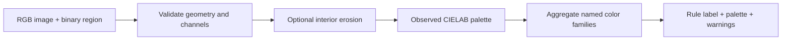
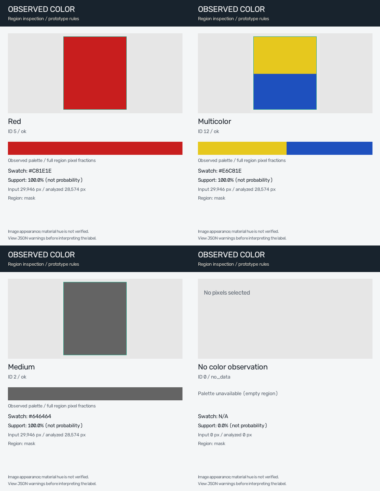

> **Current study: seven-method comparison COMPLETE.** [ผลทดลองภาษาไทย](REPORT.md) · [สรุปย่อ](RESULTS_SUMMARY_TH.md) · [สำหรับนำเสนอ](PRESENTATION_SUMMARY_TH.md) · [Protocol](EXPERIMENT_PROTOCOL.md) · [Canonical tables](reports/color-methods-20261101/METHOD_RESULTS.csv) · [Current state](STUDY_STATE.json).
>
> ใช้ 614 oracle garment regions จาก Validation ที่เลือก 100 ภาพ (97 ภาพมี regions ผ่านเกณฑ์). MLP นำ strict accuracy **68.73%**; M4 นำ fixed12 macro F1 **58.07%**; M5 ensemble ที่ fit จริงได้ accuracy **66.29%**. เป็น exploratory subset comparison; ยังไม่ใช่คะแนน CCTV หรือ benchmark เต็ม 5,000 ภาพ. Default API ยังเป็น rules v2. [Data/terms](DATASET_DETAILS.md) · [Schema](DATA_SCHEMA.md) · [Setup/artifacts](docs/METHOD_COMPARISON_SETUP.md).

# Garment Color Extractor

CPU library for describing **observed colors inside an image region**. Supply a garment mask, bounding box, or cropped image; receive a palette, heuristic color label, and structured quality notes.

**Current engine: `prototype_rules_v2` (v1.1.0).** It uses fixed rules and prototypes. It does not bundle trained model weights. A separate research M5 ensemble has now been fitted and evaluated on the shared pilot membership; its explicit local artifact is documented in the current report and is not the default API engine. Historical CCIHP/CCTV scores do **not** validate this implementation. See [review findings](reports/COLOR_REVIEW_TH.md), [benchmark evidence](benchmark/README.md), and [changes](CHANGELOG.md).

## What the library does



1. Validate the image and region. Preserve an empty region as `no_data`.
2. Optionally erode the mask boundary, retaining the original when too few pixels remain. Erosion can reduce edge contamination; it does not guarantee a clean garment mask.
3. Convert sampled pixels to OpenCV CIELAB/HSV and fit a deterministic palette with up to four clusters. Palette weights describe all analyzed pixels; a single-color region has one cluster.
4. Map clusters through lightness/chroma gates and fixed weighted-Euclidean prototypes. Aggregate same-family mass before selecting the dominant label or a heuristic multicolor label.
5. Return observed swatches, palette weights, region provenance and warnings. A legacy 58-element descriptor exists internally but is **not** an ensemble classifier input.

CIELAB conversion and clustering do not recover illumination-invariant material color. Shadows, reflections, white balance, low saturation and infrared imagery can change the observation. A grayscale/IR image cannot establish an object's original visible-light hue.

## Install

Python 3.8+ is declared in package metadata; this revision was tested locally on Python 3.12. No Python 3.8 execution claim is made.

```bash
pip install -e .
# Optional REST service
pip install -e '.[api]'
# Development tests
pip install -e '.[api,dev]'
```

No model weights or GPU libraries are required by this package. Runtime depends on region size, CPU, thread settings and library versions; there is no verified fixed millisecond guarantee.

## Python usage

```python
import cv2
from garment_color import GarmentColorExtractor, create_color_card

image_bgr = cv2.imread('person.jpg')
mask = cv2.imread('shirt_mask.png', cv2.IMREAD_GRAYSCALE) > 0
extractor = GarmentColorExtractor()
result = extractor.predict(image_bgr, mask=mask, is_bgr=True, garment_type='upper')

print(result.to_json(indent=2))
image_rgb = cv2.cvtColor(image_bgr, cv2.COLOR_BGR2RGB)
card = create_color_card(image_rgb, mask, result)
cv2.imwrite('color_diagnostic.png', card)  # Card is BGR.
```

For boxes, use `bbox=(x1, y1, x2, y2)` without `mask`. Coordinates are half-open XYXY, clipped to the image; fractional minima are floored and maxima ceiled. Non-intersecting/reversed boxes raise `ValueError`. A box may include background or other body parts; it is not garment segmentation. With neither mask nor bbox the entire image is the region, and the result carries a warning.

Use parsing masks from the selected parsing pipeline in real integrations. The [synthetic boxes example](examples/yolo_integration.py) illustrates data flow only: it does not execute YOLO, tracking, Re-ID, or validated upper/lower segmentation.

## Output contract

| Field | Meaning |
|---|---|
| `algorithm_id` | `prototype_rules_v2`, an explicit behavior identity |
| `status` | `ok` or `no_data`; observation availability, not accuracy acceptance |
| `color_id` / `color_name` | Heuristic label in the 12-color vocabulary; `0` means uncharacterized |
| `hex_code` / `rgb_swatch` | The same observed representative color; both null for an empty region |
| `palette` | Observed RGB/HEX, pixel fractions and rule class for each retained cluster; weights sum to one for nonempty input |
| `confidence` | Legacy field: supporting named-color-family pixel fraction, **not** correctness probability. Multicolor uses the two leading families' combined fraction |
| `score_kind` | Explicit interpretation of the legacy score |
| `calibrated_probability` | Always null; no probability calibration artifact is available |
| `region_source` | `mask`, `bbox`, or `whole_image` |
| `input_pixels` / `total_pixels` | Region area before / after optional erosion |
| `erosion_retained_fraction` | Actual analyzed fraction, null for an empty region |
| `warnings` | Low chroma, very dark/highlight region, small/empty input and input-region limitations |
| `is_multicolor` | Rule detected multiple separated named color families; it does not classify garment patterns |
| `latency_ms` | This call's wall-clock diagnostic, not a benchmark or latency SLA |

Inputs must be nonempty uint8 RGB/BGR arrays of shape `(H, W, 3)` or file paths. Masks must match `(H, W)` with bool, 0/1, or 0/255 values. Multiclass label maps require explicit selection of a garment before calling. Supported region types: `upper`, `lower`, `hair`, `other`.

## Color vocabulary

| ID | Label | ID | Label |
|---|---|---|---|
| 0 | Uncharacterized | 7 | Yellow |
| 1 | Dark | 8 | Orange |
| 2 | Medium | 9 | Green |
| 3 | Light | 10 | Blue |
| 4 | Brown | 11 | Purple |
| 5 | Red | 12 | Multicolor |
| 6 | Pink | | |

Registry swatches are illustrations of category names, not recovered garment colors. `Multicolor` has no single representative hue; the returned HEX and palette remain actual observations rather than the registry's magenta marker. Dark/Blue and other category boundaries are heuristic and need task-specific independent validation.

## CLI and API

```bash
garment-color --image person.jpg --mask shirt_mask.png --type upper --json
uvicorn api.server:app --host 127.0.0.1 --port 8000
```

`POST /api/v1/extract-color` accepts `image_base64`, optional binary `mask_base64` or `bbox`, `garment_type`, and `apply_erosion`. It returns the same structured result as Python. Invalid image data returns 400; invalid region contracts return 422. `/health` reports engine/version identity. The optional `api` module is included in the built distribution. This is a runnable integration example, not an operational deployment certification.

## Diagnostic preview

The following cards are generated from synthetic RGB regions, with no dataset or CCTV assets:



Regenerate with `python examples/render_diagnostics.py`.

## Verification and evidence

```bash
python -m unittest discover -s tests -v
```

Tests cover hand-specified regions/colors, empty and thin masks, full palette mass, label aggregation, RGB/BGR, input rejection, actual API serialization and diagnostic card dimensions. They do not measure real-scene color accuracy.

- [Technical review in Thai](reports/COLOR_REVIEW_TH.md)
- [Benchmark evidence and limitations](benchmark/README.md)
- [Change log / migration](CHANGELOG.md)
- [Historical README snapshot](docs/history/README_before_review.md)

CCTV images, names, annotations, thumbnails, masks, and private review manifests are external assets and are not published in this repository. Existing benchmark JSON files remain unchanged historical evidence. No corrected-package CCIHP/CCTV accuracy, supervised-M5 performance, or clean timing ranking is asserted.

License: [MIT](LICENSE), unchanged by this review.


## Optional learned T4 pilot

A new, bounded experiment trained a small **62→64→32→12 MLP on Tesla T4**. It is separate from the default rule engine and from the historical M5 ensemble. See the [actual pilot report](reports/T4_COLOR_PILOT_TH.md) and [frozen protocol](configs/T4_COLOR_PILOT_PROTOCOL.json).

The run used 300 Training images for fitting, 50 disjoint Training images for checkpoint selection and 100 official Validation images for evaluation. There was no new parsing inference. CCTV examples use existing masks as qualitative observations, with no independent color-accuracy claim.

Weights are retained locally at `outputs/t4-pilot-20261101/learned_color.pt` and are **not** automatically redistributed. Code licensing does not by itself resolve the terms of artifacts learned from noncommercial dataset annotations. An authorized local artifact can be used with [examples/learned_checkpoint.py](examples/learned_checkpoint.py), passing its exact SHA256 and an actual garment mask. The optional module requires the `learned` extra; training in this review reused an existing compatible environment without installing dependencies.

```python
from garment_color.learned import LearnedColorPredictor
from garment_color.preprocessor import MaskPreprocessor

# image_rgb: uint8 RGB; garment_mask: matching binary region from the parser.
pixels = MaskPreprocessor().extract_clean_pixels(image_rgb, garment_mask, True)
model = LearnedColorPredictor('outputs/t4-pilot-20261101/learned_color.pt',
                              device='cpu', expected_sha256='<SHA256 from pilot report>')
result = model.predict_pixels(pixels, native_category=5)  # 5, 7, 9, or 12
```

Softmax scores are not calibrated correctness probabilities. This pilot does not switch the service's default engine or establish CCTV deployment readiness. Reproduction requires external CIHP RGB/CCIHP annotations and the recorded environment; clone alone is insufficient.
