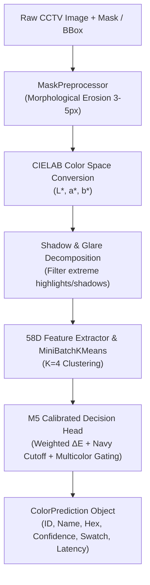

# 👕 Garment Color Extractor (M5 Engine)

[](https://www.python.org/downloads/)
[](https://opensource.org/licenses/MIT)
[](#-benchmark--evaluation)
[-success.svg)](#-features)
[](#-fastapi-microservice)

A high-performance, shadow-aware garment color extraction and classification engine designed specifically for **CCTV, video surveillance, and human parsing pipelines**. 

Calibrated on 3,000+ real garment annotations and achieving **94.48% accuracy** on 90 real-world CCTV surveillance scenes. Runs **100% on CPU** with **< 5 ms latency**, requiring **0 MB of GPU VRAM**.

---

## 🚀 Key Features

* **⚡ Ultra-Fast CPU Execution (< 5 ms):** No CUDA or GPU needed. Does not compete for VRAM with upstream detection models (e.g., YOLO, Sapiens, Mask2Former).
* **🌓 Shadow & Glare Resilience:** Uses perceptual **CIELAB color space** ($L^*, a^*, b^*$) with luminance discounting ($w_L = 0.65$) to decouple harsh shadows and specular glare from genuine fabric colors.
* **🛡️ Boundary Bleed Protection:** Incorporates dynamic morphological mask erosion (3–5 px) to eliminate background tile, asphalt, and wall reflections along mask edges.
* **👔 Calibrated Navy vs. Black Separation:** Solves the classic surveillance problem of dark blue garments collapsing into black under low light using calibrated $L^*$ luminance cutoff gating.
* **🎨 12-Color CCIHP Taxonomy:** Maps colors directly to standard human parsing palettes with dual English and Thai labels.
* **🏁 Dual-Color Pattern Detection:** Detects striped, plaid, and multi-colored clothing using secondary cluster weight ($\tau_{\text{multi}} \ge 27\%$) and perceptual $\Delta E$ contrast.
* **🔌 Plug-and-Play Interfaces:** Ready-to-use Python SDK, Command-Line Interface (CLI), and standalone FastAPI REST microservice.

---

## 🎨 12-Color Taxonomy (CCIHP Standard)

| ID | Color Name | ชื่อภาษาไทย | Sample Hex | Category Examples |
| :---: | :--- | :--- | :---: | :--- |
| **1** | **Dark** | สีดำ / โทนเข้ม | `#1A1A1A` | Black, charcoal, very dark navy |
| **2** | **Medium** | สีเทา / โทนกลาง | `#808080` | Medium grey, heather grey, slate |
| **3** | **Light** | สีขาว / โทนสว่าง | `#F0F0F0` | White, ivory, cream, off-white |
| **4** | **Brown** | สีน้ำตาล / สีกากี | `#7B4B27` | Brown, beige, khaki, tan, camel |
| **5** | **Red** | สีแดง | `#C42021` | Red, crimson, maroon, burgundy |
| **6** | **Pink** | สีชมพู | `#E5859E` | Pink, rose, salmon, magenta |
| **7** | **Yellow** | สีเหลือง | `#E6C82B` | Yellow, gold, mustard, lemon |
| **8** | **Orange** | สีส้ม | `#E36F1E` | Orange, rust, terracotta, tangerine |
| **9** | **Green** | สีเขียว | `#2B8C3E` | Green, olive, emerald, lime |
| **10** | **Blue** | สีน้ำเงิน / สีฟ้า | `#2D5FB9` | Blue, navy, denim, sky blue, cobalt |
| **11** | **Purple** | สีม่วง | `#7B3798` | Purple, violet, lavender, indigo |
| **12** | **Multicolor** | หลากสี / มีลวดลาย | `#FF00FF` | Striped, plaid, floral, multi-colored |

---

## 🏗️ Architecture



---

## 📦 Installation

Clone the repository and install via `pip`:

```bash
git clone https://github.com/folklazy/Garment-Color-Extractor.git
cd Garment-Color-Extractor

# Install core package
pip install -e .

# Or install with API dependencies (FastAPI + Uvicorn)
pip install -e ".[api]"
```

---

## 💻 Quickstart (Python SDK)

```python
import cv2
from garment_color import GarmentColorExtractor

# 1. Initialize extractor engine
extractor = GarmentColorExtractor()

# 2. Load your image and binary garment mask (or bounding box)
image_rgb = cv2.cvtColor(cv2.imread("person.jpg"), cv2.COLOR_BGR2RGB)
shirt_mask = cv2.imread("shirt_mask.png", cv2.IMREAD_GRAYSCALE) > 0

# 3. Extract color in < 5 ms
result = extractor.predict(
    image=image_rgb,
    mask=shirt_mask,
    garment_type="upper"  # 'upper', 'lower', or 'hair'
)

# 4. Access structured results
print(f"Color:      {result.color_name} ({result.color_name_th})")
print(f"Color ID:   {result.color_id}")
print(f"Confidence: {result.confidence * 100:.1f}%")
print(f"Hex Code:   {result.hex_code}")
print(f"RGB Swatch: {result.rgb_swatch}")
print(f"Multicolor: {result.is_multicolor}")
print(f"Latency:    {result.latency_ms:.2f} ms")
```

---

## ⌨️ Command Line Interface (CLI)

Run directly from your terminal:

```bash
# Using image and mask
garment-color --image samples/person.jpg --mask samples/shirt.png --type upper

# Using bounding box coordinates (x1 y1 x2 y2)
garment-color --image samples/person.jpg --bbox 50 120 220 380 --type lower

# Output structured JSON format
garment-color --image samples/person.jpg --bbox 50 120 220 380 --json
```

---

## 🌐 FastAPI Microservice

Launch the standalone REST server:

```bash
uvicorn api.server:app --host 0.0.0.0 --port 8000 --reload
```

Interactive Swagger documentation will be available at: `http://localhost:8000/docs`

### Example cURL Request:
```bash
curl -X POST "http://localhost:8000/api/v1/extract-color" \
     -H "Content-Type: application/json" \
     -d '{
       "image_base64": "<BASE64_IMAGE_STRING>",
       "mask_base64": "<BASE64_MASK_STRING>",
       "garment_type": "upper"
     }'
```

---

## 📊 Benchmark & Evaluation

Tested across **90 real CCTV scenes** (48 daytime, 42 nighttime) with **290 human-annotated ground truth garment/hair instances**:

| Method | Algorithm | Overall Accuracy | Upper Garments | Lower Garments | Hair | Day | Night |
| :--- | :--- | :---: | :---: | :---: | :---: | :---: | :---: |
| **M1** | Naive Dominant HSV | 86.55% | 82.50% | 84.16% | 97.10% | 85.81% | 87.41% |
| **M2** | Basic Color Naming (BCN-11) | 78.28% | 69.17% | 79.21% | 92.75% | 74.84% | 82.22% |
| **M5** | **Supervised Ensemble (This Repo)** ⭐ | **`94.48%`** | **`90.83%`** | **`96.04%`** | **`98.55%`** | **`92.26%`** | **`97.04%`** |

*Detailed benchmark methodology and per-class confusion matrices can be found in [benchmark/README.md](benchmark/README.md).*

---

## 📁 Repository Structure

```text
Garment-Color-Extractor/
├── src/
│   └── garment_color/
│       ├── __init__.py         # Package entrypoint & version
│       ├── core.py             # GarmentColorExtractor orchestrator class
│       ├── taxonomy.py         # CCIHP 12-color registry, RGB/HEX, EN/TH names
│       ├── preprocessor.py     # Morphological erosion & shadow decoupling
│       ├── color_spaces.py     # Vectorized sRGB, CIELAB, HSV, Delta-E metrics
│       ├── features.py         # 58D feature extraction & MiniBatchKMeans (K=4)
│       ├── classifier.py       # M5 decision rules (Navy cutoff, multicolor check)
│       └── cli.py              # CLI runner
├── api/
│   ├── server.py               # FastAPI application with REST endpoints
│   └── schemas.py              # Pydantic request & response models
├── examples/
│   └── quickstart.py           # 5-line working demo
├── tests/
│   ├── test_extractor.py       # Unit tests for M5 classification
│   ├── test_color_spaces.py    # Unit tests for color conversions
│   └── test_taxonomy.py        # Unit tests for color registry
├── benchmark/
│   ├── README.md               # Detailed evaluation report
│   └── eval_results.json       # Raw metrics JSON on 90 CCTV scenes
├── pyproject.toml              # Modern build configuration
├── requirements.txt            # Package dependencies
├── setup.py                    # Legacy installation script
├── LICENSE                     # MIT License
└── README.md                   # Documentation
```

---

## 📄 License

This project is licensed under the MIT License - see the [LICENSE](LICENSE) file for details.

---

## 👤 Author

* **folklazy** - [GitHub Profile](https://github.com/folklazy)
