# 👕 Garment Color Extractor (M5 Engine)

[](https://www.python.org/downloads/)
[](https://opensource.org/licenses/MIT)
[-brightgreen.svg)](#-academic-benchmark--ablation-study-m1-to-m5)
[-success.svg)](#-key-features)
[](#-key-features)
[](#-fastapi-microservice)

A lightweight, shadow-aware garment color extraction and classification framework for **Human Parsing, Person Re-Identification (Re-ID), and Surveillance Video Analytics**.

Evaluated on the academic **CCIHP (Crowd Instance-level Human Parsing with Color Attributes)** benchmark across **1,265 human-annotated validation garments**. Outperforms classical color naming baselines by **+12.02% in Relaxed Accuracy** and **2.15x in Macro-F1**, while running **100% on CPU** in **< 3.2 ms** with **0 MB GPU VRAM**.

---

## 🔬 Framework Architecture (Paper-Style Overview)

The proposed **M5 Engine** operates as an interpretable four-stage perceptual pipeline, decoupling illumination artifacts from intrinsic fabric pigmentation through physical color space decomposition and calibrated statistical clustering:

```mermaid
flowchart LR
    subgraph S1 ["1. Boundary Denoising"]
        A["Image I<br>Mask M"] --> B["Dynamic Erosion<br>Kernel: 2-5px"]
    end

    subgraph S2 ["2. Color Decoupling"]
        B --> C["sRGB → CIELAB<br>(L*, a*, b*)"]
        C --> D["Shadow / Glare<br>Decomposition"]
    end

    subgraph S3 ["3. Cluster Representation"]
        D --> E["MiniBatch K-Means<br>(K=4 in LAB)"]
        E --> F["58D Feature<br>Vector f"]
    end

    subgraph S4 ["4. Calibrated Decision Head"]
        F --> G["Achromatic Gate<br>(Chroma < 11.5)"]
        G --> H["Navy Cutoff<br>(L* = 26.78)"]
        H --> I["Weighted ΔE<br>(w_L = 0.65)"]
        I --> J["Multicolor Gate<br>(τ = 27%)"]
    end

    J --> Out["Prediction y<br>(ID, HEX, Conf)"]

    style S1 fill:#f9f9fb,stroke:#4a5568,stroke-width:1px
    style S2 fill:#edf2f7,stroke:#2b6cb0,stroke-width:1px
    style S3 fill:#ebf8ff,stroke:#3182ce,stroke-width:1px
    style S4 fill:#f0fff4,stroke:#38a169,stroke-width:1px
    style Out fill:#e6fffa,stroke:#319795,stroke-width:2px
```



*Figure 1: Architectural overview of the M5 Garment Color Extraction Framework.*

### How It Works (Four-Stage Physical Intuition)

1. **Stage 1: Boundary Denoising ($\mathbf{M} \to \mathbf{M}_{\text{core}}$):**
   * *Problem:* Segmentation masks from neural networks often bleed 2–4 pixels into the background (skin, wall, tile).
   * *Solution:* Dynamic morphological erosion using an elliptical structuring element ($\mathbf{K} \in \{3\times3, 5\times5\}$) extracts the core fabric region, eliminating edge contamination.
2. **Stage 2: Perceptual Color Decoupling ($\text{sRGB} \to \text{CIELAB}$):**
   * *Problem:* In RGB/HSV, brightness is coupled with hue; shadows cause light clothes to look dark or grey.
   * *Solution:* Transformation into **CIE $L^*a^*b^*$ space** decouples lightness ($L^* \in [0, 100]$) from chroma ($a^*, b^*$). Harsh shadows ($L^* < 12$) and specular glares ($L^* > 98$) are isolated without corrupting fabric chroma.
3. **Stage 3: Multi-Centroid Cluster Representation (58D Feature Vector):**
   * *Problem:* Clothing often contains folds, shadows, textures, or secondary pattern stripes.
   * *Solution:* Fast **MiniBatch $K$-Means ($K=4$)** in CIELAB extracts primary and secondary cluster centroids $(\mathbf{c}_1, \mathbf{c}_2)$ and area weights $(w_1, w_2)$. Together with multi-channel quantiles and variances, a compact **58-dimensional perceptual feature vector** is formed.
4. **Stage 4: Calibrated Decision Head ($\mathbf{f}_{58} \to \hat{y} \in \{1, \dots, 12\}$):**
   * **Achromatic Gate:** Evaluates metric chroma $C^* = \sqrt{a^{*2} + b^{*2}}$. If $C^* < 11.5$, routes to Light (White), Medium (Grey), or Dark (Black).
   * **Calibrated Navy Gate:** Addresses dark blue vs. black ambiguity with a calibrated luminance threshold ($L^* = 26.78, b^* < -8.0$).
   * **Weighted $\Delta E$ Prototype Matching:** Uses luminance-discounted perceptual distance ($\Delta E_{\text{weighted}} = \sqrt{0.65 \Delta L^{*2} + \Delta a^{*2} + \Delta b^{*2}}$) against empirical CCIHP cluster centers.
   * **Multicolor Gate:** Triggers `12 Multicolor` if secondary cluster weight $w_2 \ge 27\%$ and $\Delta E(\mathbf{c}_1, \mathbf{c}_2) \ge 22.0$.

---

## 📊 Academic Benchmark & Ablation Study (M1 to M5)

Evaluated under strict academic protocols on **1,265 Oracle Ground Truth garments** across 200 validation images from the **CCIHP** benchmark (3,017 calibration garments from Training Set, **zero data leakage**):

### Overall Ablation Results (M1 to M5)

| Method ID | Method Description | Color Representation | Single-11 Acc (%) | Relaxed Semantic Acc (%) | CPU Latency |
| :---: | :--- | :--- | :---: | :---: | :---: |
| **M1** | Heuristic HSV Thresholding | Naive RGB/HSV rule-based | 73.12% | 80.00% | 1.1 ms |
| **M2** | Basic Color Naming (*van de Weijer 2009*) | 11-Color pixel lookup table | 66.33% | 79.05% | 4.8 ms |
| **M3** | Shadow-Aware CIELAB Clustering | MiniBatch K-Means ($K=4$) + LAB | 74.39% | 89.25% | 2.5 ms |
| **M4** | Category-Conditioned Prior Head | M3 + Upper/Lower garment priors | 74.57% | 89.17% | 2.6 ms |
| **M5** | **Supervised 58D Palette Ensemble** 🏆 | **Full 58D vector + calibrated decision head** | **`77.47%`** | **`91.07%`** | **`3.2 ms`** |

### Per-Category Performance (M1 to M5 Relaxed Accuracy)

| Garment Category | Instance Count ($N$) | M1 (HSV) | M2 (BCN11) | M3 (CIELAB) | M4 (Prior) | **M5 (Ensemble)** 🏆 |
| :--- | :---: | :---: | :---: | :---: | :---: | :---: |
| **Coat (Jackets / Blazers / Outerwear)** | 304 | 80.92% | 80.59% | 91.45% | 90.79% | **`94.08%`** |
| **Pants (Trousers / Jeans / Shorts)** | 397 | 85.46% | 77.69% | 90.98% | 91.98% | **`93.23%`** |
| **UpperClothes (Shirts / T-shirts / Tops)** | 487 | 78.03% | 79.26% | 87.68% | 87.89% | **`89.32%`** |
| **Skirt (Skirts / Dress-bottoms)** | 77 | 60.00% | 78.67% | 81.33% | 76.00% | **`78.67%`** |
| **Hair (Natural Hair Shades)** | — | 90.56% | 91.57% | 88.20% | 91.23% | **`93.42%`** |
| **All Garments Combined** | **1,265** | **80.00%** | **79.05%** | **89.25%** | **89.17%** | **`91.07%`** |

*Complete benchmark breakdowns and confusion matrices are available in [benchmark/README.md](benchmark/README.md).*

---

## 🎨 12-Color Taxonomy (CCIHP Standard)

| ID | Color Name | ชื่อภาษาไทย | Sample Hex | Category Examples |
| :---: | :--- | :--- | :---: | :--- |
| **1** | **Dark** | สีดำ / โทนเข้ม | `#1A1A1A` | Black, charcoal, deep navy, dark tone |
| **2** | **Medium** | สีเทา / โทนกลาง | `#808080` | Medium grey, heather grey, slate, mid-tone |
| **3** | **Light** | สีขาว / โทนสว่าง | `#F0F0F0` | White, ivory, cream, off-white, light pastel |
| **4** | **Brown** | สีน้ำตาล / สีกากี | `#7B4B27` | Brown, beige, khaki, tan, coffee, camel |
| **5** | **Red** | สีแดง | `#C42021` | Red, crimson, maroon, burgundy, scarlet |
| **6** | **Pink** | สีชมพู | `#E5859E` | Pink, rose, salmon, peach, magenta |
| **7** | **Yellow** | สีเหลือง | `#E6C82B` | Yellow, gold, mustard, lemon |
| **8** | **Orange** | สีส้ม | `#E36F1E` | Orange, rust, terracotta, tangerine |
| **9** | **Green** | สีเขียว | `#2B8C3E` | Green, olive, emerald, lime, forest green |
| **10** | **Blue** | สีน้ำเงิน / สีฟ้า | `#2D5FB9` | Blue, navy, denim, sky blue, cobalt |
| **11** | **Purple** | สีม่วง | `#7B3798` | Purple, violet, lavender, indigo, lilac |
| **12** | **Multicolor** | หลากสี / มีลวดลาย | `#FF00FF` | Striped, plaid, floral, multi-colored |

---

## 📦 Installation

```bash
git clone https://github.com/folklazy/Garment-Color-Extractor.git
cd Garment-Color-Extractor

# Install core library
pip install -e .

# Or install with REST API dependencies (FastAPI + Uvicorn)
pip install -e ".[api]"
```

---

## 💻 Usage Examples

### 1. Basic Python SDK

```python
import cv2
from garment_color import GarmentColorExtractor

# 1. Initialize engine
extractor = GarmentColorExtractor()

# 2. Load image and binary mask (or bounding box)
image_rgb = cv2.cvtColor(cv2.imread("person.jpg"), cv2.COLOR_BGR2RGB)
shirt_mask = cv2.imread("shirt_mask.png", cv2.IMREAD_GRAYSCALE) > 0

# 3. Extract garment color (< 3.2 ms on CPU)
result = extractor.predict(
    image=image_rgb,
    mask=shirt_mask,
    garment_type="upper"  # 'upper', 'lower', or 'hair'
)

print(f"Color:      {result.color_name} ({result.color_name_th})")
print(f"Color ID:   {result.color_id}")
print(f"Confidence: {result.confidence * 100:.1f}%")
print(f"Hex Code:   {result.hex_code}")
print(f"RGB Swatch: {result.rgb_swatch}")
print(f"Multicolor: {result.is_multicolor}")
print(f"Latency:    {result.latency_ms:.2f} ms")
```

### 2. End-to-End Person Re-ID Pipeline (YOLO + Garment Color)

```python
from garment_color import GarmentColorExtractor

extractor = GarmentColorExtractor()

# Extract attributes from detected bounding boxes
upper_bbox = (120, 80, 260, 230)
lower_bbox = (120, 230, 260, 420)

upper_pred = extractor.predict(image=frame_rgb, bbox=upper_bbox, garment_type="upper")
lower_pred = extractor.predict(image=frame_rgb, bbox=lower_bbox, garment_type="lower")

person_attributes = {
    "upper_color": upper_pred.color_name,
    "lower_color": lower_pred.color_name,
    "upper_hex": upper_pred.hex_code,
    "lower_hex": lower_pred.hex_code,
}
```
*(See [examples/yolo_integration.py](examples/yolo_integration.py) for the complete runnable script).*

### 3. Generate Visual Diagnostic Swatch Card

```python
import cv2
from garment_color import GarmentColorExtractor, create_color_card

extractor = GarmentColorExtractor()
pred = extractor.predict(image_rgb, mask=shirt_mask, garment_type="upper")

# Generate visual inspection card with cropped garment & swatch
diagnostic_card = create_color_card(image_rgb, shirt_mask, pred)
cv2.imwrite("color_diagnostic.png", diagnostic_card)
```

### 4. Command Line Interface (CLI)

```bash
# Using image and mask
garment-color --image person.jpg --mask shirt.png --type upper

# Using bounding box coordinates (x1 y1 x2 y2)
garment-color --image person.jpg --bbox 50 120 220 380 --type lower

# Output raw JSON
garment-color --image person.jpg --bbox 50 120 220 380 --json
```

---

## 🌐 FastAPI REST Microservice

Launch the standalone production server:

```bash
uvicorn api.server:app --host 0.0.0.0 --port 8000 --reload
```

Interactive Swagger documentation is available at: `http://localhost:8000/docs`

```bash
curl -X POST "http://localhost:8000/api/v1/extract-color" \
     -H "Content-Type: application/json" \
     -d '{
       "image_base64": "<BASE64_IMAGE_STRING>",
       "mask_base64": "<BASE64_MASK_STRING>",
       "garment_type": "upper"
     }'
```

---

## 📁 Repository Structure

```text
Garment-Color-Extractor/
├── src/
│   └── garment_color/
│       ├── __init__.py         # Package entrypoint (v1.0.0)
│       ├── core.py             # GarmentColorExtractor orchestrator class
│       ├── taxonomy.py         # CCIHP 12-color registry, RGB/HEX, EN/TH names
│       ├── preprocessor.py     # Morphological erosion & shadow decoupling
│       ├── color_spaces.py     # Vectorized sRGB, CIELAB, HSV, Delta-E metrics
│       ├── features.py         # 58D feature extraction & MiniBatchKMeans (K=4)
│       ├── classifier.py       # M5 decision rules (Navy cutoff, multicolor check)
│       ├── visualizer.py       # Visual diagnostic card generator
│       └── cli.py              # CLI runner
├── api/
│   ├── server.py               # FastAPI application with REST endpoints
│   └── schemas.py              # Pydantic request & response models
├── examples/
│   ├── quickstart.py           # 5-line minimal working demo
│   └── yolo_integration.py     # End-to-end Person Re-ID detection pipeline
├── tests/
│   ├── test_extractor.py       # Unit tests for M5 classification
│   ├── test_color_spaces.py    # Unit tests for color conversions
│   └── test_taxonomy.py        # Unit tests for color registry
├── benchmark/
│   ├── README.md               # Detailed evaluation report on CCIHP benchmark
│   ├── eval_results.json       # Structured benchmark statistics (1,265 garments)
│   └── ccihp_benchmark_summary.json # Raw validation pilot log
├── pyproject.toml              # Modern build configuration
├── requirements.txt            # Package dependencies
├── setup.py                    # Legacy installation script
├── LICENSE                     # MIT License
└── README.md                   # Documentation
```

---

## 📄 License

This project is licensed under the MIT License - see the [LICENSE](LICENSE) file for details.

---

## 👤 Author

* **folklazy** - [GitHub Profile](https://github.com/folklazy)
