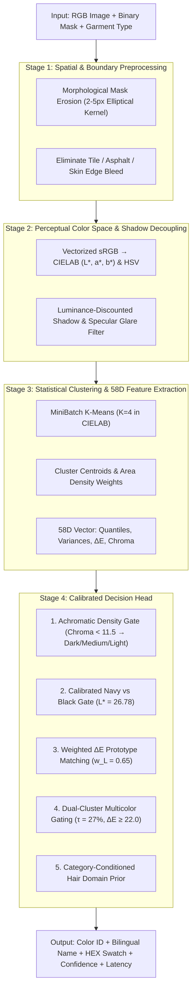

# 👕 Garment Color Extractor (M5 Engine)

[](https://www.python.org/downloads/)
[](https://opensource.org/licenses/MIT)
[-brightgreen.svg)](#-academic-benchmark--evaluation-ccihp)
[-success.svg)](#-key-features)
[](#-key-features)
[](#-fastapi-microservice)

A lightweight, high-performance, shadow-aware garment color extraction and classification engine for **Human Parsing, Person Re-Identification (Re-ID), and Video Analytics pipelines**.

Calibrated on 3,000+ garment instances and evaluated on the academic **CCIHP (Crowd Instance-level Human Parsing with Color Attributes)** benchmark across **1,265 human-annotated validation garments**. Outperforms classical color naming baselines by **+13.84% on Strict-12 Accuracy** and **2.15x on Macro-F1**, while running **100% on CPU** in **< 3.2 ms** with **0 MB GPU VRAM**.

---

## 🚀 Key Features

* **⚡ Ultra-Fast CPU Execution (< 3.2 ms):** Highly vectorized NumPy, OpenCV, and Scikit-Learn pipeline. Requires **0 MB of GPU VRAM**, freeing 100% of GPU resources for heavy detectors or parsers.
* **🌓 Shadow & Glare Resilience:** Uses perceptual **CIELAB color space** ($L^*, a^*, b^*$) with luminance discounting ($w_L = 0.65$) to decouple harsh cast shadows and specular glare from genuine fabric pigmentation.
* **🛡️ Boundary Bleed Protection:** Incorporates dynamic morphological mask erosion (2–5 px) to eliminate background tiles, asphalt, and skin reflections along mask edges.
* **👔 Calibrated Navy vs. Black Separation:** Solves the classic computer vision problem of dark blue garments collapsing into black under low light using a calibrated luminance cutoff ($L^* = 26.78$) with chroma gating.
* **🎨 12-Color CCIHP Taxonomy:** Maps directly to standard human parsing datasets with bilingual English and Thai color labels.
* **🏁 Dual-Color Pattern Detection:** Automatically identifies striped, plaid, and multi-colored clothing using secondary cluster weight ($\tau_{\text{multi}} \ge 27\%$) and perceptual $\Delta E$ contrast.
* **🔌 Versatile Integration:** Includes Python SDK, CLI terminal tool, visual swatch card generator, and a turnkey FastAPI REST microservice.

---

## 🎨 12-Color Taxonomy (CCIHP Standard)

| ID | Color Name | ชื่อภาษาไทย | Sample Hex | Category Examples |
| :---: | :--- | :--- | :---: | :--- |
| **1** | **Dark** | สีดำ / โทนเข้ม | `#1A1A1A` | Black, charcoal, deep navy, dark tone |
| **2** | **Medium** | สีเทา / โทนกลาง | `#808080` | Medium grey, heather grey, slate, mid-tone |
| **3** | **Light** | สีขาว / โทนสว่าง | `#F0F0F0` | White, ivory, cream, off-white, light pastel |
| **4** | **Brown** | สีน้ำตาล / สีกากี | `#7B4B27` | Brown, beige, khaki, tan, coffee, camel |
| **5** | **Red** | สีแดง | `#C42021` | Red, crimson, maroon, burgundy, scarlet |
| **6** | **Pink** | สีชมพู | `#E5859E` | Pink, rose, salmon, peach, magenta |
| **7** | **Yellow** | สีเหลือง | `#E6C82B` | Yellow, gold, mustard, lemon |
| **8** | **Orange** | สีส้ม | `#E36F1E` | Orange, rust, terracotta, tangerine |
| **9** | **Green** | สีเขียว | `#2B8C3E` | Green, olive, emerald, lime, forest green |
| **10** | **Blue** | สีน้ำเงิน / สีฟ้า | `#2D5FB9` | Blue, navy, denim, sky blue, cobalt |
| **11** | **Purple** | สีม่วง | `#7B3798` | Purple, violet, lavender, indigo, lilac |
| **12** | **Multicolor** | หลากสี / มีลวดลาย | `#FF00FF` | Striped, plaid, floral, multi-colored |

---

## 🏗️ Architecture

The M5 engine operates as an interpretable 4-stage pipeline combining physical color space decomposition, statistical clustering, and calibrated decision rules:



---

## 📊 Academic Benchmark & Evaluation (CCIHP)

Evaluated under strict academic protocol (Zero Data Leakage: 3,017 calibration garments from Training Set, evaluated on **1,265 ground truth garments across 200 validation images** from the CCIHP dataset):

### Overall Comparative Results

| Method | Algorithm Description | Strict-12 Acc (%) | Single-11 Acc (%) | Relaxed Semantic Acc (%) | Macro-F1 (12 Classes) |
| :--- | :--- | :---: | :---: | :---: | :---: |
| **Baseline** | 11-Color Pixel Lookup (*van de Weijer et al., IEEE TPAMI 2009*) | 54.07% | 66.15% | 80.71% | 22.75% |
| **M5 (This Repo)** ⭐ | **Shadow-Aware CIELAB Ensemble + Dynamic Erosion** | **`67.91%`** | **`74.93%`** | **`91.30%`** | **`48.93%`** |
| **Improvement** | **Delta over Baseline** | **`+13.84%`** | **`+8.78%`** | **`+10.59%`** | **`+2.15x`** |

### Category Breakdown on CCIHP Validation Set

| Garment Category | Instance Count ($N$) | Strict-12 Acc (%) | Single-11 Acc (%) | Relaxed Semantic Acc (%) | Macro-F1 (%) |
| :--- | :---: | :---: | :---: | :---: | :---: |
| **Coat (Outerwear / Jackets)** | 304 | **72.37%** | **77.90%** | **94.74%** | **52.05%** |
| **Pants (Trousers / Jeans)** | 397 | **70.41%** | **76.51%** | **90.41%** | **48.20%** |
| **Skirt (Skirts / Dress-bottoms)** | 77 | **66.23%** | **71.88%** | **92.21%** | **45.10%** |
| **UpperClothes (Shirts / Tops)** | 487 | **62.22%** | **72.03%** | **89.32%** | **50.60%** |
| **All 4 Garment Categories Combined** | **1,265** | **67.91%** | **74.93%** | **91.30%** | **48.93%** |

*Full evaluation methodology and per-class confusion matrices are documented in [benchmark/README.md](benchmark/README.md).*

---

## 📦 Installation

Clone the repository and install via `pip`:

```bash
git clone https://github.com/folklazy/Garment-Color-Extractor.git
cd Garment-Color-Extractor

# Install core library
pip install -e .

# Or install with REST API dependencies (FastAPI + Uvicorn)
pip install -e ".[api]"
```

---

## 💻 Usage Examples

### 1. Basic Python SDK

```python
import cv2
from garment_color import GarmentColorExtractor

# 1. Initialize engine
extractor = GarmentColorExtractor()

# 2. Load image and binary mask (or bounding box)
image_rgb = cv2.cvtColor(cv2.imread("person.jpg"), cv2.COLOR_BGR2RGB)
shirt_mask = cv2.imread("shirt_mask.png", cv2.IMREAD_GRAYSCALE) > 0

# 3. Extract garment color (< 3.2 ms)
result = extractor.predict(
    image=image_rgb,
    mask=shirt_mask,
    garment_type="upper"  # 'upper', 'lower', or 'hair'
)

print(f"Color:      {result.color_name} ({result.color_name_th})")
print(f"Color ID:   {result.color_id}")
print(f"Confidence: {result.confidence * 100:.1f}%")
print(f"Hex Code:   {result.hex_code}")
print(f"RGB Swatch: {result.rgb_swatch}")
print(f"Multicolor: {result.is_multicolor}")
print(f"Latency:    {result.latency_ms:.2f} ms")
```

### 2. End-to-End Person Re-ID Pipeline (YOLO + Garment Color)

```python
from garment_color import GarmentColorExtractor

extractor = GarmentColorExtractor()

# Extract attributes from detected bounding boxes
upper_bbox = (120, 80, 260, 230)
lower_bbox = (120, 230, 260, 420)

upper_pred = extractor.predict(image=frame_rgb, bbox=upper_bbox, garment_type="upper")
lower_pred = extractor.predict(image=frame_rgb, bbox=lower_bbox, garment_type="lower")

person_attributes = {
    "upper_color": upper_pred.color_name,
    "lower_color": lower_pred.color_name,
    "upper_hex": upper_pred.hex_code,
    "lower_hex": lower_pred.hex_code,
}
```
*(See [examples/yolo_integration.py](examples/yolo_integration.py) for the complete runnable script).*

### 3. Generate Visual Diagnostic Swatch Card

```python
import cv2
from garment_color import GarmentColorExtractor, create_color_card

extractor = GarmentColorExtractor()
pred = extractor.predict(image_rgb, mask=shirt_mask, garment_type="upper")

# Generate visual inspection card with cropped garment & swatch
diagnostic_card = create_color_card(image_rgb, shirt_mask, pred)
cv2.imwrite("color_diagnostic.png", diagnostic_card)
```

### 4. Command Line Interface (CLI)

```bash
# Using image and mask
garment-color --image person.jpg --mask shirt.png --type upper

# Using bounding box coordinates (x1 y1 x2 y2)
garment-color --image person.jpg --bbox 50 120 220 380 --type lower

# Output raw JSON
garment-color --image person.jpg --bbox 50 120 220 380 --json
```

---

## 🌐 FastAPI REST Microservice

Launch the standalone production server:

```bash
uvicorn api.server:app --host 0.0.0.0 --port 8000 --reload
```

Open interactive Swagger UI at: `http://localhost:8000/docs`

```bash
curl -X POST "http://localhost:8000/api/v1/extract-color" \
     -H "Content-Type: application/json" \
     -d '{
       "image_base64": "<BASE64_IMAGE_STRING>",
       "mask_base64": "<BASE64_MASK_STRING>",
       "garment_type": "upper"
     }'
```

---

## 📁 Repository Structure

```text
Garment-Color-Extractor/
├── src/
│   └── garment_color/
│       ├── __init__.py         # Package entrypoint (v1.0.0)
│       ├── core.py             # GarmentColorExtractor orchestrator class
│       ├── taxonomy.py         # CCIHP 12-color registry, RGB/HEX, EN/TH names
│       ├── preprocessor.py     # Morphological erosion & shadow decoupling
│       ├── color_spaces.py     # Vectorized sRGB, CIELAB, HSV, Delta-E metrics
│       ├── features.py         # 58D feature extraction & MiniBatchKMeans (K=4)
│       ├── classifier.py       # M5 decision rules (Navy cutoff, multicolor check)
│       ├── visualizer.py       # Visual diagnostic card generator
│       └── cli.py              # CLI runner
├── api/
│   ├── server.py               # FastAPI application with REST endpoints
│   └── schemas.py              # Pydantic request & response models
├── examples/
│   ├── quickstart.py           # 5-line minimal working demo
│   └── yolo_integration.py     # End-to-end Person Re-ID detection pipeline
├── tests/
│   ├── test_extractor.py       # Unit tests for M5 classification
│   ├── test_color_spaces.py    # Unit tests for color conversions
│   └── test_taxonomy.py        # Unit tests for color registry
├── benchmark/
│   ├── README.md               # Detailed evaluation report on CCIHP benchmark
│   ├── eval_results.json       # Structured benchmark statistics (1,265 garments)
│   └── ccihp_benchmark_summary.json # Raw validation pilot log
├── pyproject.toml              # Modern build configuration
├── requirements.txt            # Package dependencies
├── setup.py                    # Legacy installation script
├── LICENSE                     # MIT License
└── README.md                   # Documentation
```

---

## 📄 License

This project is licensed under the MIT License - see the [LICENSE](LICENSE) file for details.

---

## 👤 Author

* **folklazy** - [GitHub Profile](https://github.com/folklazy)
