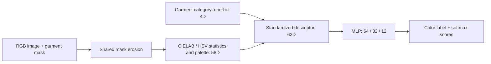

# Garment Color Extractor

Classify the **observed color of a garment region** using a compact neural network and CIELAB–HSV color descriptors. Supply an RGB image, a garment mask and its native garment category; the selected model predicts one of 12 color labels.

**Selected method: T4 MLP · 62→64→32→12 · 6,508 parameters.** It achieved the highest primary strict accuracy in the completed seven-method comparison: **68.73% (422/614 garment regions)**. This result uses an oracle-mask CCIHP subset: 100 selected validation images, with 97 contributing images. CCTV deployment accuracy has not been established.

[Method paper / รายละเอียดภาษาไทย](reports/SELECTED_COLOR_METHOD_TH.md) · [Quick start](#quick-start) · [Model identity](registry/SELECTED_METHOD.json) · [Research and evaluation](#research-and-evaluation)

## Selected method



| Property | Selected configuration |
|---|---|
| Algorithm ID | `T4_MLP_62_64_32_12_v1` |
| Color descriptor | LAB/HSV quantiles, standard deviations, palette centroids/weights and contrast statistics |
| Category input | One-hot native garment category: 5, 7, 9 or 12 |
| Network | Linear62→64, ReLU, Linear64→32, ReLU, Linear32→12 |
| Parameters | 6,508, including biases |
| Training | AdamW, FP32, 40 epochs on Tesla T4 |
| Selected checkpoint | Epoch28, selected by calibration cross-entropy |
| Normalization | Training-only mean and standard deviation, stored in the checkpoint |
| Output | Color ID1–12 and uncalibrated softmax scores |

The model classifies the supplied region. An upstream parser provides garment masks and person association. The selected checkpoint can be loaded explicitly on CPU; earlier verification found identical CPU/GPU labels on all 614 evaluated regions. No inference-speed ranking is claimed.

For equations, feature dimensions, training settings, learning curves, per-color results and limitations, read the **[selected-method paper](reports/SELECTED_COLOR_METHOD_TH.md)**.

## Quick start

### Install

```bash
python -m pip install -e '.[learned]'
```

This includes the optional PyTorch dependency. Source was tested with Python3.12; the package's declared Python3.8 minimum has not been independently verified.

### Provide the selected checkpoint

The trained artifact is stored separately from Git:

```text
outputs/t4-pilot-20261101/learned_color.pt
SHA256: 4145b416f9020422e389210af6eab6adc6d92d6c37af6033f60ffc712969bfde
```

Weights are not downloaded or distributed automatically. Obtain the authorized artifact and preserve its identity. Cloning this repository alone does not provide the checkpoint or dataset. See [artifact/setup requirements](docs/METHOD_COMPARISON_SETUP.md) and [dataset terms](DATASET_DETAILS.md).

### Predict a garment color

```python
import cv2

from garment_color.learned import LearnedColorPredictor
from garment_color.preprocessor import MaskPreprocessor

# A readable image and matching binary mask for one garment region.
image_bgr = cv2.imread('person.jpg')
mask_gray = cv2.imread('upper_clothes_mask.png', cv2.IMREAD_GRAYSCALE)
image_rgb = cv2.cvtColor(image_bgr, cv2.COLOR_BGR2RGB)
garment_mask = mask_gray > 0

pixels = MaskPreprocessor().extract_clean_pixels(
    image_rgb, garment_mask, apply_erosion=True
)
model = LearnedColorPredictor(
    'outputs/t4-pilot-20261101/learned_color.pt',
    device='cpu',
    expected_sha256='4145b416f9020422e389210af6eab6adc6d92d6c37af6033f60ffc712969bfde',
)
result = model.predict_pixels(pixels, native_category=5)
print(result['color_id'])
print(result['softmax'])
```

Load the model once and reuse it across regions. The file-based [example](examples/learned_checkpoint.py) additionally validates image/mask inputs and accepts explicit checkpoint, hash and category arguments.

## Input and output contract

| Input | Requirement |
|---|---|
| Image | uint8 RGB; convert OpenCV BGR before extracting pixels |
| Mask | Binary mask on the original image grid for one person × one garment |
| Preprocessing | Existing shared erosion policy; do not recompute the trained scaler |
| Native category | 5 UpperClothes, 7 Coat, 9 Pants or 12 Skirt |

A generic Upper/Lower mask alone does not distinguish Coat from UpperClothes or Pants from Skirt. Define the upstream category binding before integrating another parser; do not silently substitute a category or split a dress with an undeclared heuristic.

| Field | Meaning |
|---|---|
| `status` | `ok` for a nonempty observation; `no_data` for an empty region |
| `color_id` | Native color ID1–12; 0 for `no_data` |
| `softmax` | Twelve scores in native class order; null for `no_data` |
| `calibrated_probability` | Null on normal predictions; absent in the current empty-region response. Calibration is not established |
| `algorithm_id` | Exact learned-model identity |

Color order: **Dark, Medium, Light, Brown, Red, Pink, Yellow, Orange, Green, Blue, Purple, Multicolor**. Dark includes navy under the CCIHP reference. Softmax scores are not calibrated confidence, and the learned wrapper does not itself return the rule engine's palette/card schema.

This describes appearance under the image's lighting. It does not recover illumination-invariant material color; grayscale/IR imagery cannot establish an object's original visible-light hue.

## Project navigation

| Purpose | Start here |
|---|---|
| Understand and use the selected method | This README and [method paper](reports/SELECTED_COLOR_METHOD_TH.md) |
| Inspect the selected implementation | [Model](src/garment_color/learned.py), [features](src/garment_color/features.py), [mask preprocessing](src/garment_color/preprocessor.py) |
| Check selection and current state | [Selection record](registry/SELECTED_METHOD.json), [study state](STUDY_STATE.json) |
| Inspect experiments and benchmark evidence | [Research section below](#research-and-evaluation) |
| Review software checks | [`tests/`](tests/) and [verification section below](#software-verification) |

## Research and evaluation

Experimental comparisons and test evidence are kept separate from the selected-method usage above.

<details>
<summary><strong>Open the seven-method comparison, protocol and result tables</strong></summary>

The study compared M1 HSV, M2 fixed-anchor projection, M3 global LAB prototypes, M4 category-conditioned LAB prototypes, a real M5 HGB/ExtraTrees/prototype ensemble, the library rules and the T4 MLP on identical eligible regions.

MLP leads the declared-primary strict accuracy at **68.73%**. **M4 leads fixed-12 macro F1 at 58.07%, versus MLP's 52.55%.** Selecting MLP preserves that trade-off; it does not establish superiority for every color or garment category. Orange/Purple have only 3/2 GT regions and no MLP true positives in this subset.

- [Full comparison report](REPORT.md)
- [Results summary in Thai](RESULTS_SUMMARY_TH.md) · [Presentation summary](PRESENTATION_SUMMARY_TH.md)
- [Evaluation protocol](EXPERIMENT_PROTOCOL.md) · [Dataset details/terms](DATASET_DETAILS.md) · [Metric schema](DATA_SCHEMA.md)
- [Canonical results](reports/color-methods-20261101/METHOD_RESULTS.csv) · [Per-color metrics](reports/color-methods-20261101/PER_CLASS.csv) · [Per-garment metrics](reports/color-methods-20261101/PER_CATEGORY.csv)
- [Run provenance](reports/color-methods-20261101/MANIFEST.json) · [Selection evidence](reports/selected-color-method/SELECTION_EVIDENCE.json)
- [Original T4 pilot report](reports/T4_COLOR_PILOT_TH.md) · [Research plan](PLAN.md) · [Work log](WORK_LOG.md)

The same 300 Training images and 50 separate calibration images were used. Validation comprises 100 selected images, 97 with eligible garments, yielding 614 regions. These are exploratory oracle-mask selection results, with no independent CCTV accuracy, statistical-significance claim or clean latency/FPS/VRAM ranking. Frozen native parsing results and historical failures remain separate.

</details>

## Software verification

<details>
<summary><strong>Open CPU checks and verification evidence</strong></summary>

Software contract tests live in [`tests/`](tests/). They cover input geometry, RGB/BGR handling, empty regions, palette mass, API serialization, explicit model artifacts, class-column alignment and independent metric examples. They do not replace dataset accuracy measurements.

In a compatible environment with the optional API/test tooling installed:

```bash
python -m unittest discover -s tests -v
```

The pilot test helpers use Pillow; the current Starlette TestClient uses `httpx2`. These test dependencies are separate from the learned-model usage above. Exact environment and prior verification evidence:

- [Pilot verification](reports/t4-pilot-20261101/VERIFICATION.json)
- [Method-comparison verification](reports/color-methods-20261101/VERIFICATION.json)
- [Comparison environment](reports/color-methods-20261101/ENVIRONMENT.json)
- [Original contract review](reports/COLOR_REVIEW_TH.md)

No dataset, trained weights or GPU benchmark is required for the synthetic CPU checks. Optional PyTorch cases require the learned extra; without it, their documented skip does not establish learned-model acceptance.

</details>

## Compatibility interface

<details>
<summary><strong>Open the existing rule-based SDK, CLI and REST service</strong></summary>

`GarmentColorExtractor`, the `garment-color` CLI and `api.server:app` still use **`prototype_rules_v2`**. They are separate from the selected learned-model entry point, `LearnedColorPredictor`. This README change does not silently replace an existing caller's engine.

```python
from garment_color import GarmentColorExtractor

extractor = GarmentColorExtractor()
result = extractor.predict(
    image_bgr, mask=garment_mask, is_bgr=True, garment_type='upper'
)
```

```bash
garment-color --image person.jpg --mask shirt_mask.png --type upper --json
uvicorn api.server:app --host 127.0.0.1 --port 8000
```

Install the optional `api` extra for the REST service. `POST /api/v1/extract-color` accepts image data and a binary mask or bounding box. It returns rule labels, observed swatches/palette and quality warnings. Its legacy `confidence` field describes supporting pixel mass, not correctness probability. Empty regions have no observed swatch.

[Synthetic diagnostic cards](examples/assets/color_diagnostics.png) illustrate the rule-based output; they are not learned-model evaluation examples. See [changes/migration](CHANGELOG.md) and [historical evidence](benchmark/README.md) for context. Imported CCIHP/CCTV benchmark JSON does not validate the current executable merely because a method name matches.

</details>

## Data, artifacts and licensing

Datasets, trained checkpoints, feature arrays, bulk predictions and private CCTV assets remain outside Git. No CCTV images, filenames, annotations or thumbnails are published. Public reports contain compact metrics, provenance and data-free figures.

First-party code: [MIT](LICENSE), unchanged. External annotations and trained artifacts have their own terms; see [data attribution and distribution](DATASET_DETAILS.md#attribution-and-distribution). Public code availability does not itself authorize redistribution or commercial use of all external assets.
