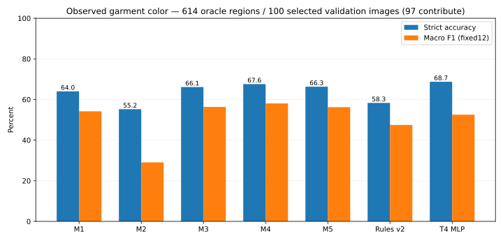
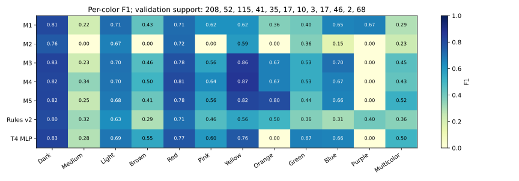

# ผลเปรียบเทียบเทคนิคสีเสื้อผ้า 7 วิธี

สถานะ **COMPLETE 7/7 configurations**, ตรวจครบวิธีละ **614 garment regions** จาก Validationที่เลือก100ภาพ โดย97ภาพมีregionsผ่านเกณฑ์; ปิด execution 2026-11-01T03:27:59.421199+07:00 เวลาไทย. Run `color-methods-20261101` / protocol `OBSERVED_GARMENT_COLOR_SEVEN_METHODS_V1`. เป็น exploratory subset study ไม่ใช่ CIHP5000ภาพ, parsing benchmark หรือ CCTV accuracy.

คะแนน strict accuracy สูงสุดคือ **T4_MLP_62_64_32_12_v1 (T4 MLP 62–64–32–12) 68.73%**; สูงกว่า M4 **1.14 percentage points**. ตัวนำ fixed12 macroF1 คือ **M4 58.07%**. ตัวเลขนี้เป็นผลที่สังเกตบนชุดนี้ ไม่ใช่ statistical significance หรือ final deployment acceptance.

## วัตถุประสงค์และสิ่งที่ทดสอบจริง

เลือกวิธีจำแนกสีที่สังเกตได้ภายใน mask เสื้อผ้า โดยให้ข้อมูล/GT/eligibility/erosion/metric เดียวกัน เปรียบเทียบ M1 HSV, M2 fixed-anchor projection, M3 global LAB prototypes, M4 category LAB prototypes, **M5 ensemble HGB+ExtraTrees+prototype ที่ fit จริง**, rules v2 และ MLP ที่ฝึกบนT4แล้ว. ไม่ใช้ M4/M5 aliasจากสคริปต์ CCTVเก่า ไม่เอาคะแนนประวัติคนละเงื่อนไขมารวม. M2ไม่ได้ใช้ learned color-name LUT ของงานตีพิมพ์.

อ่าน [protocol](EXPERIMENT_PROTOCOL.md) สำหรับสูตร/พารามิเตอร์และ [lineage](manifests/METHOD_LINEAGE.json) สำหรับต้นทาง/การดัดแปลง. นี่คือ comparison ของเทคนิคพร้อม configuration; feature/category information ต่างกัน จึงแยกผล architecture หรือองค์ประกอบทีละชิ้นไม่ได้.

## ข้อมูลและเงื่อนไข

CCIHP Color_ids1–12 เป็น reference จาก annotationเดิม ไม่สร้าง GTจากกฎสีของตัวประเมินเอง. Training300ภาพ/1,648regions สำหรับfit, Trainingอีก50ภาพ/370regions สำหรับcalibration และ Validation100ภาพ/614regions สำหรับทดสอบ. ภาพที่ให้regionsผ่านเกณฑ์จริงมี294/49/97ภาพตามลำดับ ส่วน6/1/3ภาพไม่มีeligiblegarmentregions แต่ยังคงในselectedimageaccounting ไม่ตัดตามprediction. [Population accounting](reports/color-methods-20261101/POPULATION_ACCOUNTING.json). Membershipตรึงตามpilotเดิมและ RGBhashข้ามpartitionไม่ซ้ำ. กลุ่ม native5 UpperClothes,7Coat,9Pants,12Skirt; ขอบเขตอาจรวมส่วนบน/ล่างของdress ไม่ใช่ non-Dress C4-P. หน่วยคือ person×nativecategory ไม่ใช่หนึ่งภาพหรือหนึ่งคน.

Mask≥100pixels, characterized≥80%, modalcolor≥80%ของcharacterized. กรองก่อน predictions; inputใช้maskเต็ม ไม่ตัดpixelตามColorGT. Exclusionเดิมรวม334regionsจาก450ภาพ: เล็ก86/characterizedไม่พอ248. ทุกวิธีใช้ RGBและerosionเดียวกัน. ไม่ประเมินHair/Face colorในชุดนี้.

M2–M5 fitบนTrainingเท่านั้น; thresholdเลือกบนcalibrationแยก ไม่ใช้Validation. MLP reuse checkpoint epoch28และ predictions ที่ตรวจรับแล้ว ไม่ฝึก/เลือกใหม่. Rules reuse ผลเดิมที่ผูก region orderตรงกัน. Data-dependentfittingต่างกันตามเทคนิค โดยไม่มีsearchหลังเห็นคะแนนรอบนี้.

## ผลรวม — frozen method order

| วิธี | ถูก/ทั้งหมด | Strict accuracy % | Macro F1 fixed12 % |
|---|---:|---:|---:|
| M1 — HSV rules | 393/614 | 64.01 | 54.19 |
| M2 — 11-anchor soft projection | 339/614 | 55.21 | 29.05 |
| M3 — Global LAB prototypes | 406/614 | 66.12 | 56.35 |
| M4 — Category LAB prototypes | 415/614 | 67.59 | 58.07 |
| M5 — HGB + ExtraTrees + prototype | 407/614 | 66.29 | 56.22 |
| prototype_rules_v2 — Library rules v2 | 358/614 | 58.31 | 47.47 |
| T4_MLP_62_64_32_12_v1 — T4 MLP 62–64–32–12 | 422/614 | 68.73 | 52.55 |

Canonical [METHOD_RESULTS.csv](reports/color-methods-20261101/METHOD_RESULTS.csv) เก็บfullprecision/completeness/origin; [predictions](reports/color-methods-20261101/VALIDATION_PREDICTIONS.csv) และ [confusions](reports/color-methods-20261101/CONFUSIONS.json) ตรวจเลขย้อนกลับได้. ไม่มีmissing/failed/invalid. ค่า N/Aในruntimeหมายถึงยังไม่ได้วัด ไม่ใช่0.

## ราย garment category — strict accuracy % (จำนวนregions)

| วิธี | UpperClothes5 | Coat7 | Pants9 | Skirt12 |
|---|---:|---:|---:|---:|
| M1 | 60.16 (256) | 65.47 (139) | 69.95 (183) | 55.56 (36) |
| M2 | 54.30 (256) | 53.24 (139) | 56.28 (183) | 63.89 (36) |
| M3 | 59.77 (256) | 71.22 (139) | 71.04 (183) | 66.67 (36) |
| M4 | 62.11 (256) | 69.06 (139) | 74.86 (183) | 63.89 (36) |
| M5 | 60.55 (256) | 76.98 (139) | 66.67 (183) | 63.89 (36) |
| prototype_rules_v2 | 51.56 (256) | 60.43 (139) | 63.93 (183) | 69.44 (36) |
| T4_MLP_62_64_32_12_v1 | 63.28 (256) | 74.10 (139) | 71.58 (183) | 72.22 (36) |

ตารางนี้ไม่ใช่คะแนนtarget upper/lower parsing; เป็นสีของoracle regionตามnativegarment. ค่ารวมถ่วงตามจำนวนregions ไม่ใช่เฉลี่ยสี่categoryเท่ากัน. รายละเอียด [PER_CATEGORY.csv](reports/color-methods-20261101/PER_CATEGORY.csv).

## รายสี — F1 %

| Color | GT support | M1 | M2 | M3 | M4 | M5 | Rules v2 | T4 MLP |
|---|---:|---:|---:|---:|---:|---:|---:|---:|
| Dark | 208 | 81.09 | 75.98 | 82.56 | 81.97 | 82.16 | 80.18 | 82.79 |
| Medium | 52 | 21.62 | 0.00 | 22.54 | 34.15 | 25.29 | 32.37 | 28.17 |
| Light | 115 | 71.43 | 66.67 | 70.12 | 69.70 | 68.18 | 63.25 | 69.01 |
| Brown | 41 | 43.24 | 0.00 | 45.95 | 50.00 | 41.18 | 29.03 | 54.79 |
| Red | 35 | 71.43 | 72.22 | 78.26 | 80.56 | 77.92 | 70.59 | 77.11 |
| Pink | 17 | 62.07 | 0.00 | 56.00 | 64.29 | 56.25 | 46.15 | 60.00 |
| Yellow | 10 | 62.07 | 58.82 | 85.71 | 86.96 | 81.82 | 55.56 | 76.19 |
| Orange | 3 | 36.36 | 0.00 | 66.67 | 66.67 | 80.00 | 50.00 | 0.00 |
| Green | 17 | 40.00 | 36.36 | 53.33 | 53.33 | 44.44 | 36.36 | 66.67 |
| Blue | 46 | 65.49 | 15.38 | 70.33 | 66.67 | 65.88 | 30.51 | 65.88 |
| Purple | 2 | 66.67 | 0.00 | 0.00 | 0.00 | 0.00 | 40.00 | 0.00 |
| Multicolor | 68 | 28.81 | 23.20 | 44.69 | 42.62 | 51.56 | 35.59 | 50.00 |

Darkรวมnavyตามdataset; Mediumคือgray/Lightคือwhiteตามreference. Multicolorคือlabelของregion ไม่ใช่paletteหลายclusterโดยอัตโนมัติ. ValidationOrangeมีเพียง3/Purple2regions จึงยังสรุปความทนทานสีหายากไม่ได้. Accuracyให้น้ำหนักตามจำนวนregions; fixed12macroF1ให้น้ำหนักแต่ละสีเท่ากัน ไม่สร้างweightedscoreใหม่. [PER_CLASS.csv](reports/color-methods-20261101/PER_CLASS.csv) มีTP/FP/FN/P/R/F1และsupport; [CONFUSION_ERRORS.csv](reports/color-methods-20261101/CONFUSION_ERRORS.csv) แสดงคู่ผิดทั้งหมดตามจำนวน.

## การตรวจและหลักฐาน execution

- Four independent CPU acceptance cases: HSVsingle/multicolor/empty, M5 class-column alignmentและhand-calculatedblend, calibrationtie, descriptor84D/finite/palette mass. ไม่ใช้จำนวนtestsแทนsemanticaccuracy.
- ตรวจ RGB/GTshaและfull-mask/erosion/label/pixelcountsขณะอ่าน450ภาพเท่าที่ใช้; exactregionsตรงparentทุกpartition. ไม่audit/hasharchiveทั้งหมดใหม่.
- M5มี Upper/Lower headsอย่างละHGB180iterations/ET250trees, feature96D. Export `classic_m2_m5.joblib` **11,298,309bytes**, SHA256 `a5e6010341dc21d1a3706e96ae4f8325da8c4ea4626fc1db6e88b0dfd688f809`. โหลดกลับแล้วpredictionsM1–M5ตรงกันทั้งหมด614regions. ชื่อนี้เป็น configurationของprotocolใหม่ ไม่อ้างว่าweightเดียวกับงานวิจัยเก่า.
- IndependentPythonCounterยืนยันconfusion, correct/N, macroF1, per-categoryรวมกลับglobal และreuseสองวิธีตรงparentทุกprediction. Frozen source/parent hashesตรง; nativeparserresults/GT/legacycoloroutputsไม่เปลี่ยน.
- CPU threads2; เวลาทั้งกระบวนการ 235.1s/peakRSS 950.7MiB เป็นoperationaldiagnostics ไม่ใช่latencyของวิธีใด. M1–M5ใช้CPU; MLPใช้ผลartifactที่ฝึกT4แล้ว ไม่ทำGPUcallsใหม่หรือฝึกซ้ำ.
- [VERIFICATION.json](reports/color-methods-20261101/VERIFICATION.json), [FIT_EVIDENCE.json](reports/color-methods-20261101/FIT_EVIDENCE.json), [ENVIRONMENT.json](reports/color-methods-20261101/ENVIRONMENT.json), [MANIFEST.json](reports/color-methods-20261101/MANIFEST.json) ผูกsource/launch/parent/model/ผล. Hashระบุbytesในเครื่อง ไม่ได้ยืนยันauthenticityหรือannotationcorrectnessจากผู้สร้าง.

Calibration thresholds (ตรึงสูตรก่อนfit ไม่เปลี่ยนตามValidation):

| Head | Calibration regions | Multicolor regions | Threshold |
|---|---:|---:|---:|
| M2:GLOBAL | 370 | 28 | 0.770 |
| M3:GLOBAL | 370 | 28 | 0.230 |
| M4:UPPER | 232 | 18 | 0.420 |
| M4:LOWER | 138 | 10 | 0.310 |

Clustering warnings ที่บันทึก: `{'One of the clusters is empty. Re-run kmeans with a different initialization.': 41}`. Finite/descriptor/palette checksผ่าน; ไม่ซ่อนwarningทั่วprocess. [Schema](DATA_SCHEMA.md) อธิบายdenominators/units/null.

## ข้อสรุปและสิ่งที่ยังกล่าวไม่ได้

MLP ถูกมากกว่า M4 เพียง7regionsจาก614 หรือ1.14percentagepoints แต่ macroF1 ของ M4 สูงกว่า MLP5.52percentagepoints. จึงเสนอให้เก็บทั้งสองเป็นshortlist: MLPเมื่อให้ความสำคัญกับจำนวนregionที่ถูกโดยรวม และM4เมื่อให้ความสำคัญกับความสมดุลรายสี. ไม่ประกาศว่าความต่างมีนัยสำคัญ.

M5ไม่ได้ชนะโดยรวม แม้มีความซับซ้อนกว่า แต่ทำCoatได้76.98%สูงสุดในชุดนี้; M4นำPants74.86%; MLPนำUpperClothes63.28%และSkirt72.22%. เป็นผลเชิงพรรณนา ไม่ได้พิสูจน์สาเหตุของความต่าง. M2มีmacroF1ต่ำและบางสีไม่มีTP; ไม่เปลี่ยนthresholdเพื่อช่วยผลValidation.

ใช้ T4_MLP_62_64_32_12_v1เป็น **candidateที่นำด้านstrictaccuracyบนชุดนี้** และพิจารณา M4เมื่อสนใจความสมดุลรายสี; ดูผลรายcategory/rareclassesประกอบ. ไม่เปลี่ยนdefaultAPIengineโดยอัตโนมัติ. ถ้าทั้งสองเป้าหมายชี้คนละตัวต้องรายงานtrade-off ไม่บังคับรวมคะแนนเพื่อให้มีผู้ชนะเดียว.

ผลยังพึ่งoraclemaskและknownnativecategory ซึ่งใช้งานจริงอาจผิดจากparser. ความต่างอาจมาจากfeatures/categoryconditioning/calibration/prior/algorithmร่วมกัน ไม่พิสูจน์เหตุเชิงarchitecture. ชุดValidationนี้เคยเปิดดูผลrules/MLPแล้ว จึงไม่ใช่ independentfinalconfirmation; ไม่มีuncertaintytest และหลายregionจากภาพเดียวกันมีความสัมพันธ์. ไม่อ้างว่าโมเดลชนะบนCCTV/nightIR หรือคืนสีวัสดุที่แท้จริงจากแสงได้.

ไม่ได้จัดอันดับlatency/FPS/VRAM เพราะไม่มีcleanmeasurementเดียวกันทุกวิธี. ไม่เอาเวลาทั้งสคริปต์หรือT4trainingpeakไปเป็นinferencecost. CCTVgallery12ภาพจากpilotเดิมเป็นqualitative-only ไม่มีindependentcolorGTaccuracy และไม่ขยายประเมินใหม่ในรอบนี้. ภาพ/ชื่อไฟล์/labelsCCTVไม่ขึ้นpublicGit.

## โครงรายงานแบบ YOLO และการทำต่อ

ตรวจอ่านต้นแบบจริงตาม [protocol](EXPERIMENT_PROTOCOL.md#yolo-format-reused): ใช้fixedorder/protocol/canonicaltables/schema/provenance/ข้อจำกัด/Thaihandoff. แทนMOTSsequence/APด้วยcolor/category/regionclassification; ไม่คัดลอกFPSrankingหรือแก้YOLOrepo.

Artifactsภายนอก: `<Garment-Color-Extractor>/outputs/color-methods-20261101/` เก็บjoblib,descriptors,predictions,regions,log/process/runmanifest; parentmodelอยู่ `outputs/t4-pilot-20261101/`. ไม่แจกdataset/weightsอัตโนมัติ. [Setup/reproduction](docs/METHOD_COMPARISON_SETUP.md) ระบุinput/env/คำสั่ง; cloneอย่างเดียวไม่พอ. Publictablesใช้ตรวจarithmeticได้โดยไม่ต้องมีภาพ.

ขั้นต่อไปที่มีประโยชน์คือทบทวนความต้องการdeploymentและreferenceCCTVcolorที่เชื่อถือได้ แล้วอนุมัติการประเมินปลายทางแยก; รอบนี้หยุดหลังส่งมอบ ไม่เปิดfullbenchmarkใหม่หรือparsinginference. [Thai summary](RESULTS_SUMMARY_TH.md) / [presentation](PRESENTATION_SUMMARY_TH.md).
