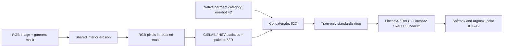
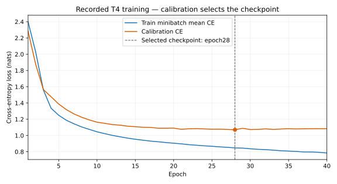

# การจำแนกสีเสื้อผ้าจาก CIELAB–HSV descriptors ด้วยโครงข่าย MLP ขนาดเล็ก

**Garment Color Classification Using CIELAB–HSV Descriptors and a Compact Multilayer Perceptron**

รายงานทางเทคนิคและคำตัดสินเลือกวิธีของโครงการ Garment Color Extractor · สถานะ **SELECTED_FOR_NEXT_PHASE** · Decision `COLOR_METHOD_SELECTION_20261101`

**วิธีที่เลือก: `T4_MLP_62_64_32_12_v1`** — MLP ขนาด 6,508 พารามิเตอร์ สำหรับจำแนกสีที่สังเกตได้ภายใน garment mask เป็น 12 กลุ่มสี เลือกจาก strict accuracy ซึ่งเป็นเกณฑ์หลักที่ประกาศก่อนการเปรียบเทียบ ผลนี้ใช้เลือก configuration หลักสำหรับงานขั้นถัดไป โดยยังแยกจากการรับรองใช้งานจริงบน CCTV

เอกสารนี้เป็น method profile และบันทึกการเลือกหลังการทดลอง ไม่ใช่บทความที่ผ่าน peer review และไม่เสนอว่า MLP หรือการใช้ CIELAB เป็นเทคนิคใหม่ รายงานเปรียบเทียบครบทั้งเจ็ดวิธียังคงอยู่ที่ [REPORT.md](../REPORT.md); ตัวเลข canonical และประวัติการทดลองเดิมไม่เปลี่ยน

## บทคัดย่อ

งานนี้ศึกษาการจำแนกสีเสื้อผ้าที่ปรากฏในภาพ โดยรับ RGB pixels ภายใน mask ของเสื้อผ้าและประเภทเสื้อผ้า แปลงการกระจายสีเป็น descriptor 58 มิติจาก CIELAB, HSV และ color palette แล้วต่อ one-hot ของประเภทเสื้อผ้าอีก 4 มิติ ก่อนป้อนเข้า MLP โครงสร้าง 62→64→32→12 ฝึกด้วย AdamW บน Tesla T4 แบบ FP32 ใช้ CCIHP Training ที่เลือก 300 ภาพสำหรับฝึก และอีก 50 ภาพสำหรับเลือก checkpoint จาก calibration loss การประเมินใช้ Validation ที่เลือกไว้ 100 ภาพ ซึ่ง 97 ภาพมี garment regions ผ่านเกณฑ์ รวม 614 regions

MLP ทำนายถูก **422/614 regions (68.73%)** สูงสุดในเจ็ด configurations และสูงกว่า M4 ที่เป็นอันดับสอง **1.14 percentage points** อย่างไรก็ตาม M4 มี fixed-12 macro F1 สูงกว่า: **58.07% เทียบกับ 52.55% ของ MLP** เราจึงเลือก MLP ตามเกณฑ์หลักเดิม พร้อมรายงานข้อด้อยรายสีและความไม่แน่นอนของชุดข้อมูลขนาดเล็ก ผลรองรับการเลือกวิธีบน oracle garment regions ในชุดนี้ ยังไม่ยืนยันความแม่นยำเมื่อ mask มาจาก parser หรือเมื่อใช้กับภาพ CCTV/IR

## 1. ปัญหาและเหตุผลของการเลือก

เป้าหมายคือให้ระบบอธิบายสีเสื้อผ้าของแต่ละคนหลัง human parsing โดย downstream pipeline ส่ง mask เสื้อผ้าและประเภทที่เกี่ยวข้องมาให้โมดูลสี การทดลองนี้แยกปัญหาสีออกจากความผิดพลาดของ parser ด้วย oracle masks เพื่อให้ทราบว่าวิธีสีแต่ละแบบทำได้ดีเพียงใดเมื่อได้รับ region ที่ถูกต้อง

เลือก **MLP เพียงตัวเดียวเป็น configuration หลักสำหรับขั้นถัดไป** ด้วยเหตุผลต่อไปนี้:

1. ทุกวิธีมีผลครบ 614 regions บนสมาชิกชุดเดียวกัน และ MLP มี strict accuracy สูงสุดตาม primary metric ที่ตรึงไว้ ไม่ได้สร้างคะแนนผสมหรือสลับไปใช้ metric ที่เอื้อโมเดลภายหลัง
2. มี trained checkpoint จริง พร้อม scaler, native class order, source/config bindings และหลักฐานโหลดกลับแล้วได้ labels ตรงกับผล GPU ทั้ง 614 regions จึงระบุตัวระบบที่จะนำไปใช้ต่อได้แน่นอน
3. การเลือกนี้ไม่อาศัยข้อสันนิษฐานว่า MLP เร็วกว่า ใช้ VRAM น้อยกว่า หรือจะดีกว่าบน CCTV เพราะยังไม่มีการวัดที่เปรียบเทียบเงื่อนไขเหล่านั้นอย่างควบคุม

**M4 เป็นตัวนำด้าน macro F1 และยังเก็บไว้เป็นผลอ้างอิง** ไม่ได้เลือกเป็นระบบหลักใน decision นี้ ส่วนต่าง accuracy ของ MLP กับ M4 มีเพียง 7 regions และยังไม่มีหลักฐาน statistical significance ดังนั้นคำว่า “ดีที่สุด” ในรายงานหมายถึง **สูงสุดตาม primary metric ในผู้สมัครและชุดประเมินนี้**

## 2. ข้อมูลและหน่วยประเมิน

ใช้ CCIHP หรือ Characterized Crowd Instance-level Human Parsing ซึ่งเพิ่ม color annotations ให้กับภาพ CIHP หน่วยประเมินของงานนี้คือ **หนึ่ง person × หนึ่ง native garment category** ในภาพ ไม่ใช่หนึ่งภาพ หนึ่ง pixel หรือบุคคลที่ไม่ซ้ำกันทั้ง dataset รายละเอียด release, attribution และเงื่อนไขการใช้ข้อมูลอยู่ใน [DATASET_DETAILS.md](../DATASET_DETAILS.md)

| Partition | ภาพที่เลือก | ภาพที่มี eligible regions | Eligible regions | การใช้งาน |
|---|---:|---:|---:|---|
| Training | 300 | 294 | 1,648 | ฝึก weights และคำนวณ scaler |
| Calibration จาก Training คนละภาพ | 50 | 49 | 370 | เลือก checkpoint ด้วย cross-entropy |
| Official Validation subset | 100 | 97 | 614 | วัดผลและเลือก configuration |

สมาชิกภาพตรึงตาม pilot เดิมก่อนฝึก MLP และมีหลักฐาน exact RGB hashes ไม่ซ้ำข้าม partitions ภาพที่ไม่มี eligible regions ยังคงอยู่ใน population accounting ไม่ได้นำออกตามผลทำนาย ดู [POPULATION_ACCOUNTING.json](color-methods-20261101/POPULATION_ACCOUNTING.json)

ประเภทเสื้อผ้า native คือ 5 UpperClothes, 7 Coat, 9 Pants และ 12 Skirt ตาม CCIHP บางส่วนของ dress อาจอยู่ใน UpperClothes/Skirt จึงต้องแยกจากนิยาม non-Dress ของ human parsing common view

Region ต้องมีอย่างน้อย 100 pixels, มี Color IDs 1–12 อย่างน้อย 80% ของ mask และมี modal color อย่างน้อย 80% ของ characterized pixels จึงใช้ modal color เป็น reference label การกรองนี้กำหนดก่อน predictions โดย Color GT **ไม่ได้ใช้คัด RGB pixels ที่ป้อนเข้าโมเดล** ทุกวิธีเห็น mask เต็มชุดเดียวกัน มี regions ที่ไม่ผ่านเกณฑ์รวม 334 รายการจาก partitions ทั้งหมด: เล็กเกินไป 86 และ characterized fraction ไม่พอ 248 รายการ

การศึกษานี้จึงวัดสีเด่นของ regions ที่มี reference ค่อนข้างชัด ไม่ครอบคลุมทุก garment region หรือ official Validation ทั้ง 5,000 ภาพ และไม่ได้ใช้ official characterized-parsing AP evaluator

## 3. วิธีที่เลือก

### 3.1 ภาพรวม

MLP ทำหน้าที่จำแนกสีของ region ที่ได้รับ ไม่ได้สร้าง person mask หรือเสื้อผ้า mask เอง และไม่ได้ใช้ CNN backbone หรือ full-image semantic context ส่วนการรักษา Person ID เป็นหน้าที่ของ upstream parsing/association pipeline

### 3.2 การเตรียม pixels

อ่านภาพเป็น RGB uint8 ที่พิกัดต้นฉบับ ใช้ binary garment mask ที่มี geometry ตรงกับภาพ ก่อนคำนวณ features ใช้ ellipse erosion 5×5 โดยต้องเหลืออย่างน้อย 40 pixels หากเหลือไม่พอ ใช้ 3×3 แล้วจึงกลับไปใช้ mask เดิมตาม policy เดิมของ `MaskPreprocessor` ไม่ทำ color jitter, white balance correction หรือเลือกเฉพาะ pixels ที่มี Color GT ตรงกับคำตอบ

การ erosion ลดการใช้ pixels บริเวณขอบได้ แต่ไม่มีหลักฐานว่าขจัด skin/background contamination ได้ทั้งหมด และไม่ได้คืนสีวัสดุที่ไม่ขึ้นกับแสง ดู implementation ที่ [preprocessor.py](../src/garment_color/preprocessor.py)

### 3.3 Descriptor 62 มิติ

RGB ถูกแปลงด้วย OpenCV เป็น CIELAB และ HSV โดย L* ถูกสเกลเป็น 0–100, a*/b* ถูกชดเชยจาก uint8 encoding, HSV hue เป็นองศา และ S/V อยู่ในช่วง 0–1 รายละเอียดที่ใช้งานจริงอยู่ใน [features.py](../src/garment_color/features.py) และ [color_spaces.py](../src/garment_color/color_spaces.py)

| กลุ่ม feature | วิธีคำนวณ | มิติ |
|---|---|---:|
| LAB quantiles | Percentiles 10,25,50,75,90 ของ L*,a*,b* | 15 |
| HSV quantiles | Percentiles เดียวกันของ H,S,V | 15 |
| Channel standard deviations | ส่วนเบี่ยงเบนมาตรฐานของ LAB และ HSV ทั้ง 6 channels | 6 |
| Leading palette clusters | LAB centroid และน้ำหนักของสาม clusters ที่มี pixels มากที่สุด; zero-pad หากมีไม่ครบ | 12 |
| Contrast/context statistics | LAB distance ของสอง clusters แรก, weight ratio, สอง cluster weights, chroma สองค่า, จำนวน pixels, median L*, median S และ median V | 10 |
| Garment category | One-hot ตามลำดับ native categories [5,7,9,12] | 4 |
| **รวม** | **58 color descriptors +4 category values** | **62** |

Palette ใช้ MiniBatchKMeans บน LAB โดย K ไม่เกิน 4 และจำกัดด้วยจำนวน pixels/สีที่ไม่ซ้ำ หาก region ใหญ่จะ fit จาก sample ไม่เกิน 2,000 pixels ด้วย seed42 แต่คำนวณ cluster weights จาก pixels ที่ป้อนทั้งหมด เก็บเฉพาะ clusters ที่มีสมาชิกจริง ตัวอย่างสีเดียวจึงไม่สร้าง secondary palette mass ขึ้นมาเอง นี่คือการใช้ implementation MiniBatchKMeans ของ scikit-learn ไม่ใช่การเสนอ clustering algorithm ใหม่ ([เอกสารต้นทาง](https://scikit-learn.org/stable/modules/generated/sklearn.cluster.MiniBatchKMeans.html))

ก่อนเข้า MLP ใช้ standardization รายมิติ:

$$z_j=\frac{x_j-\mu_j^{\mathrm{train}}}{s_j^{\mathrm{train}}}$$

ค่า mean/std มาจาก 1,648 Training regions เท่านั้น หาก std ต่ำกว่า 10⁻⁶ ใช้ scale=1 ทั้ง scaler และ weights ถูกบันทึกใน checkpoint ไม่คำนวณ scaler ใหม่จาก Calibration, Validation หรือภาพที่กำลังใช้งาน

### 3.4 สถาปัตยกรรมและจำนวนพารามิเตอร์

| Layer | รูปร่าง | Parameters รวม bias |
|---|---|---:|
| Linear1 | 62→64 | 62×64+64 =4,032 |
| ReLU | 64 | 0 |
| Linear2 | 64→32 | 64×32+32 =2,080 |
| ReLU | 32 | 0 |
| Linear3 | 32→12 | 32×12+12 =396 |
| **รวม** | | **6,508** |

ตรวจจำนวนจาก tensors ของ trained checkpoint บน CPU แล้ว ตรงกับ source `build_model()` ใน [learned.py](../src/garment_color/learned.py) ไม่มี dropout, batch normalization หรือ pretrained visual backbone การมีพารามิเตอร์น้อยไม่ได้ยืนยัน latency ของ pipeline เพราะ preprocessing และ clustering ยังมีต้นทุนที่ไม่ได้วัดแยกร่วมกันทุกวิธี

ให้ $\ell=f_\theta(z)$ เป็น logits และ $p_c=\exp(\ell_c)/\sum_{k=1}^{12}\exp(\ell_k)$ โมเดลคืน $\hat y=1+\arg\max_c\ell_c$ ตาม class order ที่เก็บไว้ ค่า softmax ยังไม่ใช่ calibrated correctness probability และไม่มี confidence threshold สำหรับตัดตัวอย่างออกจากคะแนน

### 3.5 กลุ่มสีที่ส่งออก

| ID | Reference color | ID | Reference color |
|---:|---|---:|---|
| 1 | Dark — รวม black/navy ตาม CCIHP | 7 | Yellow |
| 2 | Medium | 8 | Orange |
| 3 | Light | 9 | Green |
| 4 | Brown | 10 | Blue |
| 5 | Red | 11 | Purple |
| 6 | Pink | 12 | Multicolor |

Multicolor เป็น label ของ region ตาม annotation ไม่ใช่การมี K-Means มากกว่าหนึ่ง cluster โดยอัตโนมัติ สำหรับ input ที่ไม่มี pixels ตัว wrapper คืน `status=no_data`, color ID0 และ softmax=null; ไม่สร้าง observed gray หรือส่งค่าศูนย์ไปแทนความแม่นยำ

## 4. การฝึกและเลือก checkpoint

| รายการ | ค่าที่ใช้จริง |
|---|---|
| Hardware | Tesla T4, CUDA:0 |
| Precision | FP32; ไม่ใช้ AMP/TF32 |
| Optimizer | AdamW, learning rate0.001, weight decay0.001 |
| Objective | Unweighted 12-class cross-entropy |
| Batch size | 128 garment regions |
| Training schedule | 40 epochs; ไม่มี hyperparameter search |
| Random seed | 20261101 สำหรับ NumPy/PyTorch; clustering seed42 |
| Determinism | `torch.use_deterministic_algorithms(True)`; CUBLAS workspace ตาม protocol |
| Normalization | Training-only mean/std |
| Checkpoint selection | Calibration cross-entropy ต่ำสุด; ใช้ epoch ก่อนเมื่อเท่ากัน |
| Selected checkpoint | **Epoch28**, calibration loss **1.0702204704** |

AdamW ใช้แนวทางแยก weight decay ออกจาก adaptive update ตามงานของ Loshchilov และ Hutter; paper ดังกล่าวรองรับที่มาของ optimizer ไม่ได้ยืนยันว่าพารามิเตอร์ชุดนี้ดีที่สุดสำหรับสีเสื้อผ้า ([Decoupled Weight Decay Regularization](https://arxiv.org/abs/1711.05101)) ค่าฝึกของโครงการมาจาก [frozen pilot protocol](../configs/T4_COLOR_PILOT_PROTOCOL.json) และ [training runner](../scripts/run_t4_pilot.py)

**ภาพที่ 1.** Loss จากการฝึกเดิม 40 epochs ไม่ได้ฝึกใหม่เพื่อจัดทำรายงาน เส้น Training เป็นค่าเฉลี่ย minibatches ระหว่างอัปเดต weights ส่วน Calibration วัดหลังจบ epoch จึงมีขอบเขตการวัดต่างกัน เส้นประคือ checkpoint ที่เลือกจาก Calibration ไม่แสดงหรือใช้ Validation loss ในการเลือก checkpoint ข้อมูลเต็ม: [TRAINING_HISTORY.csv](selected-color-method/TRAINING_HISTORY.csv)

Validation ใช้เปรียบเทียบและเลือก configuration หลังการฝึก ไม่ได้ใช้เปลี่ยน weights, scaler, mapping, threshold หรือเลือก epoch การใช้ Validation เพื่อเลือกระบบหมายความว่าคะแนนชุดนี้เป็น selection evidence ไม่ใช่ independent final confirmation

## 5. Protocol และผลการทดลอง

### 5.1 นิยาม metric

Primary metric คือ strict region accuracy:

$$\mathrm{Accuracy}=\frac{\sum_{i=1}^{N}\mathbf1[\hat y_i=y_i]}{N},\qquad N=614$$

Secondary metric คือ fixed-12 macro F1 โดย $F1_c=2TP_c/(GT_c+Pred_c)$ และให้เป็น 0 เมื่อ denominator=0 ก่อนเฉลี่ยทั้ง 12 สี Precision เมื่อไม่มี predictions และ recall เมื่อไม่มี GT support เป็น null ไม่แทนด้วย 0 ดูนิยาม canonical ที่ [DATA_SCHEMA.md](../DATA_SCHEMA.md)

ทุกวิธีผ่าน exact same-population completeness ไม่มี failed/missing/invalid regions ใน comparison นี้ เปรียบเทียบ M1–M5 ที่รันจริงกับ rules และ MLP จาก accepted pilot observations เดิม ไม่ inference parser หรือฝึก MLP ซ้ำเพื่อรวมผล และไม่ใช้ relaxed-neighbor color matching

### 5.2 ผลรวมและเหตุผลตัดสิน

| Configuration | ถูก/614 | Strict accuracy % | Macro F1 % | บทบาทหลังการเลือก |
|---|---:|---:|---:|---|
| **T4 MLP** | **422** | **68.73** | 52.55 | **ระบบหลักสำหรับขั้นถัดไป** |
| M4 category LAB | 415 | 67.59 | **58.07** | ตัวนำ secondary metric; เก็บผลอ้างอิง |
| M5 HGB+ExtraTrees+prototype | 407 | 66.29 | 56.22 | ผลเปรียบเทียบ |
| Rules v2 | 358 | 58.31 | 47.47 | Default API และ baseline ปัจจุบัน |

ตารางเลือกแสดงผู้ถูกเลือก, รองอันดับ primary, ensemble และ baseline ส่วนผลทั้งเจ็ดวิธีเรียง frozen order และกราฟอยู่ใน [รายงานเปรียบเทียบ](../REPORT.md) ตัวเลขเต็มจาก [METHOD_RESULTS.csv](color-methods-20261101/METHOD_RESULTS.csv)

MLP สูงกว่า M4 1.14 percentage points, M5 2.44 points และ rules baseline 10.42 points ตาม strict accuracy แต่ macro F1 ต่ำกว่า M4 5.52 points นี่เป็นข้อแลกเปลี่ยนที่คงอยู่หลังการเลือก ไม่ได้ถูกลบด้วยการเปลี่ยน objective

### 5.3 ผลแยกตามประเภทเสื้อผ้า

| Native category | Eligible regions | MLP ถูก | Accuracy % |
|---|---:|---:|---:|
| UpperClothes5 | 256 | 162 | 63.28 |
| Coat7 | 139 | 103 | 74.10 |
| Pants9 | 183 | 131 | 71.58 |
| Skirt12 | 36 | 26 | 72.22 |

MLP สูงสุดในผู้สมัครด้าน UpperClothes และ Skirt ส่วน M5 นำ Coat และ M4 นำ Pants จึงไม่อ้างว่า MLP ชนะทุกกลุ่ม garment รายละเอียด: [PER_CATEGORY.csv](color-methods-20261101/PER_CATEGORY.csv)

### 5.4 ผลรายสีของระบบที่เลือก

| สี | GT regions | ทายเป็นสีนี้ | TP | Precision % | Recall % | F1 % |
|---|---:|---:|---:|---:|---:|---:|
| Dark | 208 | 222 | 178 | 80.18 | 85.58 | 82.79 |
| Medium | 52 | 19 | 10 | 52.63 | 19.23 | 28.17 |
| Light | 115 | 169 | 98 | 57.99 | 85.22 | 69.01 |
| Brown | 41 | 32 | 20 | 62.50 | 48.78 | 54.79 |
| Red | 35 | 48 | 32 | 66.67 | 91.43 | 77.11 |
| Pink | 17 | 13 | 9 | 69.23 | 52.94 | 60.00 |
| Yellow | 10 | 11 | 8 | 72.73 | 80.00 | 76.19 |
| Orange | 3 | 0 | 0 | N/A | 0.00 | 0.00 |
| Green | 17 | 13 | 10 | 76.92 | 58.82 | 66.67 |
| Blue | 46 | 39 | 28 | 71.79 | 60.87 | 65.88 |
| Purple | 2 | 0 | 0 | N/A | 0.00 | 0.00 |
| Multicolor | 68 | 48 | 29 | 60.42 | 42.65 | 50.00 |

ที่มา: [PER_CLASS.csv](color-methods-20261101/PER_CLASS.csv) ทั้ง Orange และ Purple ไม่มี predictions ในชุดนี้ จึงยังอ้างว่าโมเดลรองรับทุกสีได้ดีไม่ได้ ข้อมูลสองสีนี้มีเพียง 3 และ 2regions ตามลำดับ การไม่มี TP เป็นผลจริงที่ต้องรายงาน แม้จำนวนตัวอย่างยังน้อย

## 6. อภิปรายผลและการตีความ

**สิ่งที่พบจากข้อมูล:** MLP นำ primary accuracy แต่ไม่ได้นำ fixed-12 macro F1 จำนวน Dark และ Light รวมกัน 323/614 regions ทำให้ accuracy ไวต่อผลในกลุ่มที่พบมาก ขณะที่ macro F1 ให้น้ำหนักแต่ละสีเท่ากัน ความแตกต่างของสอง metrics จึงต้องรายงานควบคู่กัน

คู่สับสนที่พบมากของ MLP ได้แก่ Medium→Light20regions, Brown→Light15, Multicolor→Dark14, Multicolor→Light12, Medium→Dark11 และ Blue→Dark10 รายการเหล่านี้ได้จาก saved predictions ไม่ได้อนุมานจากภาพที่เลือกเฉพาะเพื่อสนับสนุนตัวใด และใช้เพื่ออธิบายข้อจำกัด ไม่ใช้ปรับ mapping หรือ weights หลังดู Validation ดู [CONFUSION_ERRORS.csv](color-methods-20261101/CONFUSION_ERRORS.csv)

**คำอธิบายที่เป็นไปได้ แต่ยังไม่ได้แยกทดสอบ:** class imbalance, ความต่างของ features/category conditioning และการใช้ distribution statistics ที่ไม่เก็บตำแหน่งเชิงพื้นที่ อาจมีส่วนต่อความต่างระหว่างวิธี การศึกษานี้ไม่มี ablation ที่แยกสาเหตุเหล่านั้น จึงไม่สรุปว่าเป็นข้อดีของ neural network เพียงอย่างเดียว หรือว่าเพิ่มจำนวน parameters แล้วคะแนนจะสูงขึ้น

โมเดลนี้ได้รับ native garment category เป็น input ความสามารถของ category-conditioned color classification จึงไม่เท่ากับการเดาประเภทเสื้อผ้าจากภาพเอง และความแม่นยำบน oracle masks ไม่ครอบคลุมความผิดพลาดของ upstream parser

## 7. ขอบเขตคำอ้างและข้อจำกัด

| ประเด็น | สิ่งที่หลักฐานรองรับ | ข้อจำกัด |
|---|---|---|
| การเลือกวิธี | MLP สูงสุดตาม strict accuracy ใน 7configurations บน 614 regions | ไม่มี statistical significance หรือ independent final test |
| ความสมดุลรายสี | มี per-class/support และ fixed-12 macro F1 ครบ | M4 ดีกว่าใน macro F1; MLP ไม่มี TP ของ Orange/Purple ในชุดนี้ |
| ความครบถ้วน | ทุก configuration มี exact population และ artifacts ที่ตรวจรับแล้ว | เป็น subset100 ภาพ ไม่ใช่ full 5,000-image color benchmark |
| Garment masks | ใช้ oracle geometry เดียวกันทุกวิธี | ไม่วัด end-to-end error จาก parser/association |
| Category conditioning | ใช้ native5/7/9/12 ที่มีความหมายชัดใน experiment | Coarse Upper/Lower mask อย่างเดียวไม่พอระบุ coat/pants/skirt one-hot ต้องกำหนด contract ก่อนใช้ต่อ |
| Model efficiency | ตรวจพบ 6,508 parameters และไฟล์ checkpoint30,493bytes | จำนวน parameters/ขนาดไฟล์ไม่ใช่ latency/FPS/VRAM measurement |
| ความละเอียดภาพ | ประเมินบน original-grid pixels ของชุดที่เลือก | Feature มีจำนวน pixels หลัง erosion จึงอาจไวต่อ scale/resolution; ยังไม่วัดผลบน CCTV1920×1080 อย่างควบคุม |
| สีที่ทำนาย | สีที่ปรากฏภายใต้แสงของภาพ | ไม่ใช่ intrinsic material color; grayscale/IR ไม่รับรอง visible-light hue |
| Probability | มี softmax scores จาก classifier | ยังไม่ calibrated และไม่มี selective-abstention protocol |
| ผลต่อ CCTV | มี qualitative pilot เก่าที่แยกจากคะแนนนี้ | ไม่มี independently verified CCTV color accuracy หรือ deployment acceptance |

นอกจากนี้ การใช้ hue เป็น scalar quantiles ไม่ได้จัดการวงกลมของ hue ด้วย circular statistics; เป็นข้อจำกัดของ feature definition ที่ใช้อยู่ ไม่ได้เปลี่ยนในรายงานนี้ หลาย regions ในภาพเดียวกันมีความสัมพันธ์ และชุด Validation เดิมเคยเปิดดูผลบางวิธีมาแล้ว จึงต้องระบุว่าเป็น exploratory selection study

## 8. ตัวระบบที่เลือกและการนำไปใช้ต่อ

| รายการ | Identity ที่เลือก |
|---|---|
| Algorithm ID | `T4_MLP_62_64_32_12_v1` |
| Parent training run | `t4-pilot-20261101` |
| Comparison run | `color-methods-20261101` |
| Checkpoint | `<Garment-Color-Extractor>/outputs/t4-pilot-20261101/learned_color.pt` |
| SHA256 | `4145b416f9020422e389210af6eab6adc6d92d6c37af6033f60ffc712969bfde` |
| Checkpoint bytes | 30,493 รวม weights/scaler/class-order/metadata |
| Load wrapper | `LearnedColorPredictor` จาก [learned.py](../src/garment_color/learned.py) |
| Input contract | RGB uint8 pixels หลัง shared erosion + native category5/7/9/12 |
| Output | color ID1–12 และ softmax; empty input ใช้ no_data/0/null |
| Current API default | `prototype_rules_v2` — decision นี้ยังไม่ได้เปลี่ยน API หรือ route execution |

การฝึกเดิมทำบน T4; wrapper มีหลักฐาน CPU reload labels ตรงกับ GPU ทั้ง 614 regions และ softmax allclose ตาม tolerances ที่รายงานไว้ จึงไม่ได้กำหนดว่าต้องมี T4 สำหรับอ่าน checkpoint เสมอไป แต่ยังไม่มีการจัดอันดับ inference cost ในสภาพใช้งานปลายทาง

ตัวอย่างการเรียกใช้แบบ explicit อยู่ที่ [examples/learned_checkpoint.py](../examples/learned_checkpoint.py) ผู้เรียกต้องให้ checkpoint/hash/image/mask/category เอง ไม่โหลด weights โดยอัตโนมัติ และห้ามคำนวณ scaler ใหม่จากภาพใช้งาน

ขั้นต่อไปคือใช้ **configuration นี้เป็นตัวหลัก** ในงานเชื่อมต่อ color module ภายใต้ขอบเขตที่อนุมัติแยก รักษา native-category และ mask preprocessing contract พร้อมประเมินปลายทางด้วย reference ที่มีที่มาชัดเจน การเลือกนี้ไม่อนุญาตให้รัน benchmark ใหม่ เปลี่ยน defaultAPI หรือแจกจ่าย trainedweights โดยอัตโนมัติ

## 9. การตรวจสอบย้อนกลับและการทำซ้ำ

Decision ที่เครื่องอ่านได้: [SELECTED_METHOD.json](../registry/SELECTED_METHOD.json) ส่วน [SELECTION_EVIDENCE.json](selected-color-method/SELECTION_EVIDENCE.json) ผูก canonical CSV, source/config, checkpoint, tensor shapes และ training history การตรวจรอบนี้อ่าน metadata บน CPU และคำนวณเลขจากผลที่มีอยู่เท่านั้น ไม่มีการฝึกใหม่หรือ model forward

หลักฐานเดิมที่นำมาใช้ต่อ ได้แก่ accepted pilot hashes, saved-mask/member accounting, metric arithmetic, source bindings และ exported CPU/GPU label parity ไม่รัน tests/inference ซ้ำเพียงเพื่อเพิ่มจำนวนหลักฐาน

ไฟล์ weights, dataset, feature arrays, detailed logs และภาพ CCTV อยู่ภายนอก Git ตามเดิม Public repository มี code/config/ตาราง/เอกสารและ hashes แต่ clone อย่างเดียวไม่พอทำซ้ำการทดลองโดยไม่มี external artifacts ดู [Setup](../docs/METHOD_COMPARISON_SETUP.md) และ [Data/terms](../DATASET_DETAILS.md) SHA256 ยืนยัน byte identity ที่ตรวจได้ ไม่ใช่ลายเซ็นรับรองจากผู้สร้างข้อมูล

## 10. สรุปการตัดสิน

เลือก **T4 MLP 62→64→32→12** เป็นวิธีหลักของงานจำแนกสีสำหรับขั้นถัดไป เพราะได้ **strict accuracy 68.73%สูงสุดตามเกณฑ์หลักที่ประกาศไว้** พร้อม checkpoint และหลักฐานที่ตรวจสอบย้อนกลับได้ รักษาผล secondary ที่ไม่สนับสนุนโมเดลไว้ครบ ได้แก่ macroF1 ที่ต่ำกว่า M4 และข้อผิดพลาดสีหายาก เพื่อให้การเลือกสะท้อนผลจริงและไม่กลายเป็นคำอ้างว่าดีที่สุดทุกเงื่อนไข

## เอกสารอ้างอิง

1. A. Loesch and R. Audigier. *Describe Me If You Can! Characterized Instance-Level Human Parsing.* ICIP2021, pp2528–2532. [DOI](https://doi.org/10.1109/ICIP42928.2021.9506509). อ้างอิงชื่อ/ข้อมูล release จาก README ของ annotation archive ที่ตรวจอ่าน; รอบนี้ไม่ได้เปิดฉบับเต็มผ่าน publisher
2. I. Loshchilov and F. Hutter. *Decoupled Weight Decay Regularization.* ICLR2019. [Primary paper](https://arxiv.org/abs/1711.05101). ใช้อ้างที่มาของ AdamW ไม่ใช้รับรองความเหมาะสมของ hyperparameters เฉพาะงานนี้
3. scikit-learn. [MiniBatchKMeans documentation](https://scikit-learn.org/stable/modules/generated/sklearn.cluster.MiniBatchKMeans.html). ใช้อธิบาย library algorithm; effective configuration ของการทดลองยึด source และ environment bindings
4. Project sources: [feature extractor](../src/garment_color/features.py), [learned model](../src/garment_color/learned.py), [pilot protocol](../configs/T4_COLOR_PILOT_PROTOCOL.json), [comparison protocol](../EXPERIMENT_PROTOCOL.md), [canonical results](color-methods-20261101/METHOD_RESULTS.csv). เหล่านี้เป็นแหล่งหลักของข้ออ้างเกี่ยวกับ implementation และผลโครงการ
